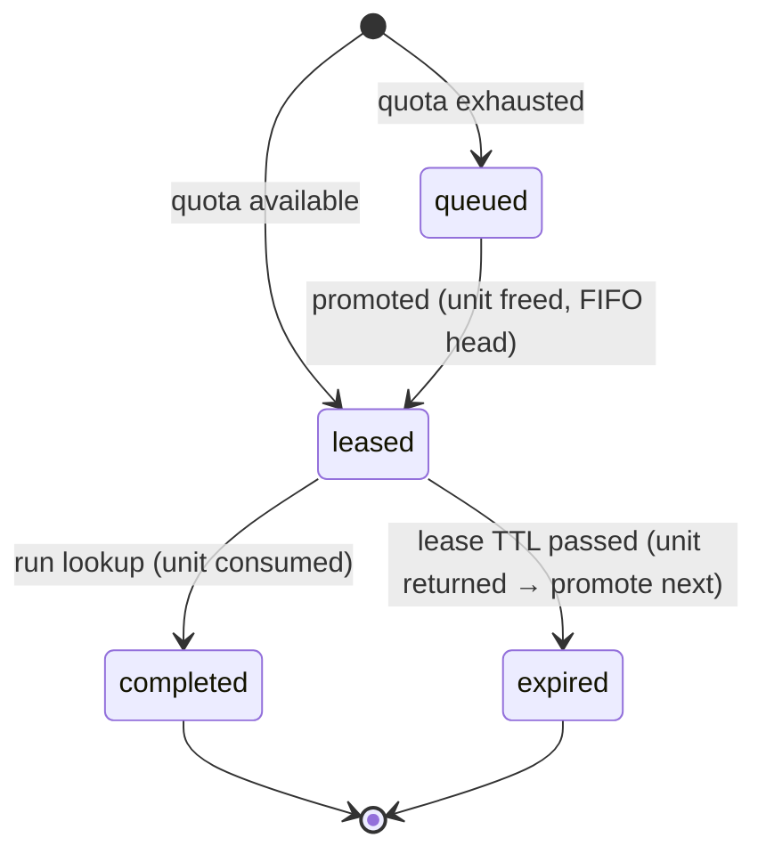

# Chat history

_Auto-generated by `scripts/ai-usage.mjs`. User prompts and assistant replies (tool calls/outputs omitted)._

## Session `bade1a1b-c274-4c22-bb5d-3174badd42e3` (2026-11-09T09:54:42.269Z → 2026-11-09T11:16:57.595Z)

### 🧑 User — 2026-11-09T10:08:53.520Z

go through the document, 

we are going to build this as a monorepo docker+docker-compose, react next on frontend, postgress for db, and laravel for backend
treat this document as source of truth, do not overbuild or overengineering till core requirements are met,  we need to start with simple architecture which must be ready to scale and incremental development. now do following

1. extract the text in an md file
2. initiate repository and push to remote
3. configure project level claude.md file, keep it precise and short and it must follow above instructions
4. setup docker + docker compose use latest stable nodejs and php, build should be optimized with hardened containers, provision volumes where required
5. setup front end and backend apps with static analsis tools, debug tools and type hardening for both PHP and nodejs/TS
6. deploy agents in parallel where required, mind token economics 
7. we need to preserve chat history and prompts as well as token utilization

once done we will start with HLD

### 🤖 Claude — 2026-11-09T10:09:49.885Z

Repo initialised. Launching the two app scaffolds in parallel (Sonnet, to keep cost down) while I do the root config, docs, and history tooling.

### 🤖 Claude — 2026-11-09T10:10:19.027Z

Now the requirements doc, root files, and CLAUDE.md.

### 🤖 Claude — 2026-11-09T10:10:43.973Z

Now the prompt/token tooling. Checking the transcript format first.

### 🤖 Claude — 2026-11-09T10:11:41.461Z

Works. Now the compose files.

### 🧑 User — 2026-11-09T10:14:33.895Z

we need small commits logical commits
before proceeding with commits we need proper git hooks for commit events like pre-commit as well as PR events, build PR templates etc

### 🤖 Claude — 2026-11-09T10:15:16.028Z

Web scaffold done and verified by the agent. Now setting up hooks and PR tooling — checking current action/tool versions first.

### 🤖 Claude — 2026-11-09T10:16:32.628Z

YAML issue (unquoted `: ` in a command). Fixing.

### 🤖 Claude — 2026-11-09T10:16:43.393Z

Hooks installed. Small fixes while the API agent finishes: ignore root `node_modules`, and bump the web app's `@types/node` to 26 (it exists, so it can match the runtime).

### 🤖 Claude — 2026-11-09T10:16:55.302Z

Web checks still pass after the bump. The API scaffold agent is still running; once it reports back I'll verify everything, then make the small logical commits and push.

### 🧑 User — 2026-11-09T10:19:27.488Z

continue or update

### 🤖 Claude — 2026-11-09T10:19:43.805Z

Correction to my last message: I haven't removed any files. I only looked at them. The API agent is still running, and its `prod` and `dev` images built about a minute ago.

The scaffolders added their own agent-instruction files:
- **`apps/web/AGENTS.md`** (from Next.js): a short pointer telling the AI to read the docs bundled with Next 16. I'll keep it, because Next 16 changed a lot.
- **`apps/api/CLAUDE.md` and `apps/api/AGENTS.md`** (from Laravel Boost): long boilerplate guidelines that get loaded whenever work touches `apps/api`, which costs tokens every time. Once the agent finishes, I plan to trim them to a pointer at the root `CLAUDE.md` unless you'd rather keep them.

Everything else is ready to commit:
- **Hooks:** lefthook runs secret scanning (gitleaks), a block on `.env` files, ESLint, Prettier and type checks for the web app, and Pint and Larastan for the API. Commit messages are checked against Conventional Commits, and tests run before each push. The hooks are installed and the config validates.
- **Pull requests:** there's a PR template and a CI workflow for commits and secrets, the web app, the API with Postgres, and the Docker image builds. None of it has run yet, because nothing is pushed.
- **Pushing:** the earlier push was rejected by GitHub's email-privacy protection. I set this repo's git email to your GitHub noreply address and threw away the two local commits so history can be redone in small steps.

When the API agent reports back, I'll check its output, then make roughly 10 small commits (repo basics, docs, AI tooling, hooks, CI, the API scaffold, the web scaffold, compose) and push to the private repo `sumit22/secnix-htask`.

### 🤖 Claude — 2026-11-09T10:21:40.666Z

The API agent's output checks out. Three things to fix before committing:
1. It installed Sanctum (an auth package). The requirements say no authentication, so that's overbuild and I'll remove it.
2. On Windows bind mounts the dev container needs to run as root.
3. The trim of the boilerplate `CLAUDE.md` I mentioned earlier.

### 🤖 Claude — 2026-11-09T10:23:38.924Z

Sanctum is gone, and lint, Larastan max and tests are all green. Now bringing the full stack up to verify the compose setup end to end.

### 🤖 Claude — 2026-11-09T10:24:55.687Z

The dev `api_vendor` volume is shadowing `vendor/` with an empty directory. Checking how the dev image lays it out.

### 🤖 Claude — 2026-11-09T10:25:00.618Z

Simplest fix: in dev, `vendor/` lives in the bind mount and is installed with `composer install` inside the container. That means no extra volume and no stale-dependency trap.

### 🤖 Claude — 2026-11-09T10:26:13.452Z

The dev stack works: migrations ran, `/up` returns 200, and Larastan passes inside compose. Quick check of the hardened prod-like stack on alternate ports:

### 🤖 Claude — 2026-11-09T10:27:37.135Z

Those six went through with the hooks. Now the app commits. PHP files will trigger Pint and Larastan inside the container.

### 🤖 Claude — 2026-11-09T10:28:15.521Z

All hooks passed: secret scan, Pint and Larastan in the container, ESLint, Prettier, typecheck and commitlint. Last commit is the AI-usage snapshot, then the push, which also runs the pre-push tests.

### 🤖 Claude — 2026-11-09T10:28:55.729Z

Pushed: 14 commits, with pre-push tests green. CI has been triggered on `main`, so I'll watch that run before calling this done.

### 🤖 Claude — 2026-11-09T10:29:10.104Z

The setup is pushed to a private repo, https://github.com/sumit22/secnix-htask, as 14 small commits. The dev stack and the hardened prod-like stack both start and pass their health checks. The first CI run on GitHub is still going; I'll report the result when it finishes.

**What's in place**
1. **Requirements:** [docs/requirements.md](docs/requirements.md) holds the full text of the PDF. The PDF itself is gitignored because it's marked confidential.
2. **Repo and history:** the first push was rejected by GitHub's email-privacy protection. I set this repo's git email to your GitHub noreply address (this repo only) and redid the history as small Conventional Commits.
3. **CLAUDE.md:** the [root file](CLAUDE.md) covers source of truth, core-first scope, quota correctness enforced in the database, and the commands. Each app has a short `CLAUDE.md` pointer. I trimmed the long boilerplate Laravel guidelines to save tokens.
4. **Docker:**
   - Versions: Node 26.13, PHP 8.5.12 with FrankenPHP 1.13.5, Postgres 18.6. Every image tag is pinned.
   - Multi-stage builds. Prod containers run as non-root with a read-only filesystem, all Linux capabilities dropped, no privilege escalation, and health checks.
   - [docker-compose.yml](docker-compose.yml) is the prod-like base and [compose.override.yml](compose.override.yml) adds dev bind mounts and debuggers. There are volumes for Postgres data, API storage and the web dependencies.
5. **Apps and tooling:**
   - API: Laravel 13 with Pint, Larastan at its strictest level, `strict_types` in every PHP file, PHPUnit, and Xdebug in the dev image.
   - Web: Next.js 16 with strict TypeScript, type-aware ESLint, Prettier, Vitest, and a Node inspector on port 9229.
6. **Git hooks and PRs:** lefthook runs before commits:
   - Before each commit: gitleaks secret scan, a block on `.env` files, ESLint, Prettier and typecheck for web, Pint and Larastan for the API.
   - On each commit message: commitlint.
   - Before each push: both test suites.
   - On GitHub: a [PR template](.github/pull_request_template.md) and a [CI workflow](.github/workflows/ci.yml) covering commits and secrets, web, the API against Postgres, and the Docker builds.
7. **Parallel agents:** the two app scaffolds ran at the same time on Sonnet to keep cost down, and I checked their work.
8. **Prompts and tokens:** [scripts/ai-usage.mjs](scripts/ai-usage.mjs) runs automatically at the end of every turn. It writes [prompts.md](docs/ai/prompts.md), [chat-history.md](docs/ai/chat-history.md) and [token-usage.md](docs/ai/token-usage.md) from the Claude Code transcripts, including the subagents. So far that's about 5.3M tokens, most of them cache reads.

**What I corrected along the way**
- The API agent installed Sanctum, an auth package. The requirements say no authentication, so I removed it.
- Fixed a dev volume that hid the API's PHP dependencies, a write-permission problem on a temp directory, and a YAML error in the hooks config.

**What you need to know**
- **API PHP files in dev are root-owned:** on Windows bind mounts, the dev API container runs as root so it can write them. Prod runs as a non-root user.
- **First-time setup:** run `npm install` at the repo root to install the hooks, and `cp .env.example .env` to create the local env file. Neither is in a README yet; that's part of the HLD and README work.

Ready to start the HLD.

### 🧑 User — 2026-11-09T10:33:15.454Z

confirm that both apps are ready for development, TDD is setup, use unitest instead of pest in laravel, what about type hardening in php and TS

### 🤖 Claude — 2026-11-09T10:33:21.013Z

Checking the current state of tests and type config in both apps.

### 🤖 Claude — 2026-11-09T10:33:45.933Z

Here's the plan for both apps. It's small, targeted hardening; nothing speculative.

### 🤖 Claude — 2026-11-09T10:34:20.187Z

Web is green: lint, typecheck, format and 4 tests. Now the API: Postgres test database, stricter static analysis, and the Pest cleanup.

### 🤖 Claude — 2026-11-09T10:35:03.617Z

First CI run: all 4 jobs passed. Continuing with the API config:

### 🤖 Claude — 2026-11-09T10:35:17.743Z

Wiring the init script into compose and CI. The existing dev volume already exists, so I'll create the test database there by hand once.

### 🤖 Claude — 2026-11-09T10:35:51.167Z

Strict rules want `self::assert*()` because PHPUnit assertions are static, and they flag the skeleton's `assertTrue(true)` placeholder. Fixing both:

### 🤖 Claude — 2026-11-09T10:36:24.881Z

The test caught a real problem: the tests aren't hitting `app_test`. Let me see which database they actually use.

### 🤖 Claude — 2026-11-09T10:36:41.020Z

Root cause: Docker injects env vars into `$_SERVER`, and Laravel reads `$_SERVER` before `$_ENV`. PHPUnit's `<env force>` only sets `$_ENV` and `putenv`. Adding matching `<server>` entries:

### 🤖 Claude — 2026-11-09T10:38:12.303Z

Pushed, with pre-push tests green. I'm watching the new CI run in the background.

### 🤖 Claude — 2026-11-09T10:38:23.767Z

Both apps are ready for test-first development. Every check passes locally, and the first CI run on `main` passed all 4 jobs. The run for the latest push is still going; I'll report it when it finishes.

**Testing setup**

| | API (Laravel) | Web (Next.js) |
|---|---|---|
| Test framework | PHPUnit 12. Pest is not installed, and I removed a leftover Pest setting from `composer.json`. | Vitest with Testing Library and jest-dom (DOM assertions for tests) |
| Test database | Real Postgres, in a separate `app_test` database | n/a |
| Watch mode | none (PHPUnit has no built-in watch) | `npm run test:watch` |
| One command for lint + types + tests | `composer check` | `npm run check` |
| Tests now | 2: home page responds, tests use the isolated test database | 4: page renders, env config validation |

**A bug the new database test caught:** tests were silently using the dev database. Laravel's test refresh would have wiped your dev data on every run. Docker passes environment variables in a way that overrode the test settings in `phpunit.xml`. I fixed it ([phpunit.xml](apps/api/phpunit.xml)), and [DatabaseTest](apps/api/tests/Feature/DatabaseTest.php) now fails if it ever happens again.

The `app_test` database is created automatically on a fresh database volume ([docker/db/init](docker/db/init/01-test-db.sh)), and CI uses the same setup.

**PHP type hardening**
- Every PHP file starts with `declare(strict_types=1)`, and the formatter (Pint) enforces it.
- PHPStan (static analysis) runs at its strictest level with Larastan for Laravel. I added the strict-rules and deprecation-rules packages and turned on checks for untyped callables and stale ignore rules.
- It now covers `tests/` as well as `app/`, `routes/` and `database/`.
- Pint also enforces strict comparisons, strict parameters, `void` return types and fully qualified type names.

**TypeScript type hardening**
- The compiler runs in `strict` mode plus `noUncheckedIndexedAccess`, `exactOptionalPropertyTypes`, `noImplicitReturns` (new), `noImplicitOverride`, `noUnused*`, `useUnknownInCatchVariables` and `verbatimModuleSyntax`.
- ESLint uses the type-aware strict and stylistic rule sets, which forbid `any`. I added rules requiring `===`, `switch` statements that handle every case, type-only imports, and no unhandled promises.

These checks run before every commit, before every push and in CI. [CLAUDE.md](CLAUDE.md) now has a short TDD section: write the failing test first, and quota and concurrency rules need tests that prove the invariant.

The prompt and token logs in `docs/ai/` update after every turn. I'm leaving them uncommitted and will commit a snapshot at milestones.

### 🧑 User — 2026-11-09T10:39:20.789Z

commit and prepare for next

### 🤖 Claude — 2026-11-09T10:40:16.037Z

Everything is committed and pushed. The working tree is clean and the dev stack is up and healthy.

- **Latest commit:** `98f7f25`, a snapshot of the prompt log, chat history and token usage (7.9M tokens so far, mostly cache reads). That makes 21 small commits on `main`, all of which went through the hooks.
- **CI:** the run for the earlier push hasn't reported yet, and this push started another. I'll report the results when they arrive.
- **Expected change:** `docs/ai/*` will show as modified after each turn, because the end-of-turn script rewrites them. I'll commit them at milestones.

**For the HLD**, I'd focus on the decisions that matter most for the core, roughly in this order:
1. **Data model:** the `quota`, `lookup_requests` (lease state machine) and `queue` tables, and which unique constraints enforce "one active lookup per indicator" and idempotency keys.
2. **Concurrency strategy:** how "never exceed quota" holds with about 200 requests at once. The options are locking the quota row (`SELECT … FOR UPDATE`), a conditional `UPDATE … WHERE remaining > 0`, or advisory locks.
3. **Lease expiry and promotion:** lazy expiry when a request comes in, a scheduler job, or both, and how the oldest queued request gets the freed unit.
4. **API contract:** the endpoints, the status values, and how the idempotency key is sent.
5. **Frontend flow:** polling vs. server-sent events for the queue position and countdown.
6. **Scope cuts:** what goes under "Known limitations".

Tell me when to start, or which of these you want to decide yourself.

### 🤖 Claude — 2026-11-09T10:40:51.440Z

The CI run for `98f7f25` is still in progress, and I'll report its result when it finishes. You can start the HLD now; nothing depends on that run.

### 🤖 Claude — 2026-11-09T10:44:21.088Z

CI passed on `98f7f25`, the latest commit on `main`. All four jobs succeeded: commits and secrets, web, the API against the Postgres test database, and the Docker image builds.

The setup is finished. Ready to start the HLD when you are.

### 🧑 User — 2026-11-09T10:48:26.534Z

When analysts investigate an indicator (an IP, domain or file hash), they 'enrich' it by querying third-party threat intelligence providers for its reputation, related malware families and so on. These integrations are usually rate-limited or quota-limited. Many analysts and automated playbooks ask for lookups at the same time, and a retried request must not burn extra quota.

this paragraph explicitly talks about providers, so we are going to build the platform supporrting multiple providers, each providers may have its own org level quota of services for the platforms

we are building one of those platforms, we need to team level quotas on top of org level quota, but start with one default team for now

Concurrency | Leases and expiry | Queue | Idempotency : these are most important and cant be ignored during implementation

correct me if i am wrong

### 🤖 Claude — 2026-11-09T10:48:49.261Z

You're mostly right. Concurrency, leases and expiry, the queue and idempotency are the core of this problem; the document's tagline lists exactly those four. Multi-provider and team quotas are a fair reading of the domain, but they go beyond what the document asks for. I'd design the schema for them and implement only the minimum.

**Where I agree**
- The background paragraph does describe multiple providers, each with its own plan quota. A real platform would key quotas by provider.
- Concurrency, leases, queue and idempotency can't be simplified away. The document's scope note names the core as request, run, expiry and never exceeding the quota.

**Where I'd push back**
1. **The task specifies one quota.** "Your provider plan has only 10 lookups remaining for today" is one provider and one counter. The document also says "a working, well-understood core is better than extra features", and reviewers will read extra scope against that. Adding `provider_id` and `team_id` columns now costs almost nothing. Building provider registries and team admin would be overbuilding.
2. **Team quotas on top of the org quota conflict with the queue rule.** The requirement says queued requests are "promoted in the order they arrived". Suppose team A has used its share while the org pool still has units. Then team B's newer request should go ahead of A's older queued one, which breaks strict FIFO. That leaves two choices:
   - FIFO within each team, with promotion skipping entries whose team cap is full. This deviates from the literal requirement and needs a note in the README.
   - Strict global FIFO, which makes team caps rarely matter.
   With one default team the conflict never shows, so I'd defer enforcing team caps rather than build logic that can't be exercised yet.
3. **Two-level reservation adds risk.** Each reserve would update the team row and the org row in one transaction, with locks taken in a fixed order to avoid deadlocks. That's doable but doubles the contention surface. I'd add it once a second team exists and can be tested.
4. **Two similar-looking rules are actually distinct.** The HLD should treat them separately:
   - Idempotency key: the same client retrying gets the same response.
   - One active lookup per indicator: a different client asking for the same indicator gets the existing lease or queue entry and spends no new unit.
   Both need unique constraints in the database, not checks in application code.
5. **"For today" implies a daily reset.** I'd store a quota window (period start and end) rather than a bare counter, so a reset is a new row and not a destructive update.

**Recommendation**
- **Schema:** `providers`, `teams` and `quota_allocations` keyed by provider, team (nullable) and period, so it can grow.
- **Implementation:** one mock provider, one seeded default team, and only the org-level quota of 10 per day enforced.
- **Core rules:** concurrency, leases, FIFO queue and idempotency done fully and tested under about 200 parallel requests.
- **README:** a note on the team-quota versus FIFO trade-off as a known extension.

Does that match what you want, or do you want team caps enforced now, with FIFO per team?

### 🧑 User — 2026-11-09T10:52:25.881Z

lets keep it simple but scalable for future, can ji see the db schema you want to propose

### 🤖 Claude — 2026-11-09T10:53:02.370Z

Here's the proposed schema: five tables, with every invariant enforced in Postgres itself. It covers multiple providers and teams, but only the org-level quota is enforced for now.

## Tables

```sql
-- 1. Providers (one mock provider seeded; more later = new rows, no schema change)
providers (
  id          bigserial PK,
  slug        varchar(50)  UNIQUE NOT NULL,   -- 'mock-intel'
  name        varchar(100) NOT NULL,
  created_at, updated_at
)

-- 2. Teams (one 'default' team seeded; used for attribution now, team caps later)
teams (
  id          bigserial PK,
  slug        varchar(50)  UNIQUE NOT NULL,   -- 'default'
  name        varchar(100) NOT NULL,
  created_at, updated_at
)

-- 3. Quota: one row per provider, scope and period (daily window)
quota_allocations (
  id            bigserial PK,
  provider_id   FK providers NOT NULL,
  team_id       FK teams NULL,                -- NULL = org-level pool (enforced now)
  period_start  timestamptz NOT NULL,         -- e.g. today 00:00 UTC
  period_end    timestamptz NOT NULL,
  quota_limit   int NOT NULL,                 -- 10
  reserved      int NOT NULL DEFAULT 0,       -- units held by active leases
  consumed      int NOT NULL DEFAULT 0,       -- units burned by completed lookups
  created_at, updated_at,
  CHECK (reserved >= 0 AND consumed >= 0),
  CHECK (reserved + consumed <= quota_limit),           -- the hard invariant
  UNIQUE NULLS NOT DISTINCT (provider_id, team_id, period_start)
)
-- remaining = quota_limit - reserved - consumed

-- 4. Lookup requests (a lease is a state of the request, not a separate table)
lookup_requests (
  id                uuid PK,                  -- public id for the status endpoint
  provider_id       FK providers NOT NULL,
  team_id           FK teams NOT NULL,
  quota_allocation_id FK quota_allocations NULL,  -- set when a unit is reserved
  analyst_id        varchar(100) NOT NULL,    -- no auth; supplied by the caller
  idempotency_key   varchar(100) NOT NULL,
  request_hash      char(64) NOT NULL,        -- sha256 of payload; same key + different payload → 422
  indicator_type    varchar(10) NOT NULL,     -- ip | domain | hash
  indicator_value   varchar(255) NOT NULL,    -- normalised (lowercased, canonical IP)
  status            varchar(10) NOT NULL,     -- queued | leased | completed | expired
  leased_at         timestamptz NULL,
  lease_expires_at  timestamptz NULL,
  completed_at      timestamptz NULL,
  expired_at        timestamptz NULL,
  result            jsonb NULL,               -- { verdict, score, malware_families[] }
  created_at, updated_at,
  CHECK (status IN ('queued','leased','completed','expired')),
  CHECK (indicator_type IN ('ip','domain','hash')),
  CHECK (status <> 'leased' OR lease_expires_at IS NOT NULL),
  UNIQUE (analyst_id, idempotency_key)                   -- idempotency
)
-- At most one active lookup per indicator, per provider:
CREATE UNIQUE INDEX lookup_requests_one_active_per_indicator
  ON lookup_requests (provider_id, indicator_type, indicator_value)
  WHERE status IN ('queued','leased');
-- Expiry sweep:
CREATE INDEX ON lookup_requests (lease_expires_at) WHERE status = 'leased';

-- 5. Waiting queue (explicit table, as the spec asks)
lookup_queue (
  id                 bigserial PK,             -- arrival order = FIFO order
  provider_id        FK providers NOT NULL,
  lookup_request_id  uuid UNIQUE NOT NULL FK lookup_requests ON DELETE CASCADE,
  enqueued_at        timestamptz NOT NULL DEFAULT now()
)
CREATE INDEX ON lookup_queue (provider_id, id);
-- position = count of rows with the same provider_id and id <= mine
```

## How each rule maps to the schema

| Rule | Enforced by |
|---|---|
| Never exceed quota (~200 concurrent requests) | `SELECT … FOR UPDATE` on the quota row inside a transaction, with the `CHECK (reserved + consumed <= quota_limit)` constraint as a backstop. Even buggy code can't overspend. |
| One active lookup per indicator | The partial unique index. If two requests race, the losing insert fails on the index; we catch that and return the existing request, spending no unit. |
| Idempotent retries | `UNIQUE (analyst_id, idempotency_key)` returns the original request. `request_hash` catches the same key reused with a different payload. |
| FIFO promotion | `lookup_queue.id` order. Promotion takes the head of the queue under row locks, skipping rows another transaction already holds. |
| Lease expiry returns the unit | A sweeper, run by the scheduler every minute plus lazily on reads, moves expired leases to `expired`, decrements `reserved`, and promotes the head of the queue in the same transaction. |
| Run consumes the unit | Lock the request: it must still be `leased` and not past its expiry. Then call the provider, then `reserved -1` and `consumed +1`, and mark it `completed`. |

## Choices worth a second look

- **Status is a `varchar` + `CHECK`, not a Postgres enum.** Adding a state later is a one-line migration.
- **No separate leases table.** A request is leased at most once; when its lease expires, the analyst re-requests. A history table can come later if needed.
- **Expired and completed requests leave the active index.** So the same indicator can be requested again afterwards.
- **Team caps later:**
  - Insert per-team rows into `quota_allocations` and lock both the team row and the org row, always in the same order.
  - Add `team_id` to `lookup_queue` for per-team FIFO.
  - No changes to existing tables.
- **Left out for now:**
  - An audit or events table.
  - Organisations as a table: the platform is single-org, so the org scope is implicit as `team_id IS NULL`.
  - Per-provider indicator-type support.

Two decisions I'd like you to confirm:
1. **Idempotency scope.** I've scoped keys per analyst, `(analyst_id, idempotency_key)`. The alternative is one global scope, which only works if clients generate UUID keys.
2. **What a duplicate indicator returns.** When a second analyst requests an indicator that's already active, I return the existing request, with its lease or queue position and later its result. The alternative is rejecting it with 409.

If this looks right, I'll write it up into `docs/hld.md` together with the API contract and the flows.

### 🧑 User — 2026-11-09T10:56:45.918Z

how this fits with laravel's user models, analysts will be a subclass of that user
we also need to define basic state machines, status definitions, enums, constants etc, some of these will be shared with frontend as well

### 🤖 Claude — 2026-11-09T10:57:26.088Z

Laravel's `users` table becomes the analyst identity. PHP enums are the single source of truth for statuses and other constants, and the TypeScript versions are generated from them so the frontend can't drift. Here's how it fits together.

## 1. Users and analysts

Analysts are a subclass of `User` stored in the same `users` table, with a `role` column telling them apart (single-table inheritance). There's no authentication: the caller passes an analyst id and we check that it exists.

```sql
users (                       -- Laravel default + 2 columns
  id, name, email, password, remember_token, timestamps,   -- password kept (unused, random) so auth can be added later
  role     varchar(20) NOT NULL DEFAULT 'analyst',  CHECK (role IN ('analyst','playbook','admin')),
  team_id  FK teams NOT NULL
)
lookup_requests.analyst_id  →  requested_by  FK users NOT NULL   -- replaces the varchar analyst_id
```

```php
class User extends Authenticatable { /* casts: role => UserRole */ }

final class Analyst extends User
{
    protected $table = 'users';

    protected static function booted(): void
    {
        static::addGlobalScope('role', fn (Builder $q) => $q->where('role', UserRole::Analyst));
        static::creating(fn (self $a) => $a->role = UserRole::Analyst);
    }
}
```

- **Why `playbook` is a role:** the spec says "analysts **and automated playbooks**" request lookups. A playbook is a service account in the same table, so adding a `Playbook` subclass later needs no schema change.
- **Snapshots on the request:** `lookup_requests.team_id` copies the user's team at request time, so quota and history stay correct if the user later changes teams.
- **Idempotency scope** becomes `UNIQUE (requested_by, idempotency_key)`.
- **Seed data:** one `default` team and a few analysts (and one playbook), so the UI can offer an analyst picker without a login screen.

## 2. Lookup state machine



| Status | Active? | Holds a unit? | Meaning |
|---|---|---|---|
| `queued` | yes | no | Waiting in `lookup_queue`; has a position |
| `leased` | yes | reserved | Can run until `lease_expires_at` |
| `completed` | no | consumed | `result` is set |
| `expired` | no | returned | The lease lapsed without a run; the analyst must request again |

- **A failed provider call is not a state.** The request stays `leased` and can be retried within the lease. This matches "a retried request must not burn extra quota".
- **Transitions live in the enum, so code can't skip a step:**

```php
enum LookupStatus: string
{
    case Queued = 'queued';  case Leased = 'leased';
    case Completed = 'completed';  case Expired = 'expired';

    /** @return list<self> */
    public function allowedTransitions(): array
    {
        return match ($this) {
            self::Queued    => [self::Leased],
            self::Leased    => [self::Completed, self::Expired],
            self::Completed, self::Expired => [],
        };
    }
    public function canTransitionTo(self $to): bool { return in_array($to, $this->allowedTransitions(), true); }
    public function isActive(): bool   { return $this === self::Queued || $this === self::Leased; }
    public function isTerminal(): bool { return $this->allowedTransitions() === []; }
}
```

Each transition is a guarded update, so the database refuses a stale move even when two workers race:

```sql
UPDATE lookup_requests SET status = 'completed', …
WHERE id = ? AND status = 'leased' AND lease_expires_at > now();
-- 0 rows affected → the transition is rejected
```

## 3. Enums and constants

| Kind | Name | Values | Shared with frontend |
|---|---|---|---|
| Enum | `LookupStatus` | queued, leased, completed, expired, plus the transition map | ✅ |
| Enum | `IndicatorType` | ip, domain, hash | ✅ |
| Enum | `Verdict` | malicious, suspicious, harmless, unknown | ✅ |
| Enum | `UserRole` | analyst, playbook, admin | ✅ |
| Enum | `ApiErrorCode` | `validation_failed`, `idempotency_key_reused`, `lease_expired`, `lease_not_active`, `not_found`, `analyst_not_found` | ✅ |
| Config | `enrichment.lease_ttl_seconds` | 300 | exposed via the API |
| Config | `enrichment.default_daily_quota` | 10 | exposed via the API |
| Config | `enrichment.quota_period` | `daily`, UTC | ❌ |

- **TTL and quota are config, not constants.** They're read from env, so tests can shorten the TTL to seconds.
- **The frontend gets them at runtime from the API,** not baked into the build.
- **Indicator type is detected server-side when omitted:**
  - Hashes by length: 32, 40 or 64 hex characters (MD5, SHA-1, SHA-256).
  - IP addresses via `filter_var`.
  - Otherwise a domain regex.
  - Values are then normalised: lowercased, canonical IP.

## 4. Sharing with the frontend

PHP enums are the source of truth. An artisan command generates the TypeScript side:

```
php artisan contracts:export   →   apps/web/src/contracts/generated.ts   (committed)
```

```ts
// generated.ts — DO NOT EDIT
export const LookupStatus = { Queued: "queued", Leased: "leased", Completed: "completed", Expired: "expired" } as const;
export type LookupStatus = (typeof LookupStatus)[keyof typeof LookupStatus];
export const LOOKUP_TRANSITIONS: Record<LookupStatus, readonly LookupStatus[]> = { queued: ["leased"], leased: ["completed", "expired"], completed: [], expired: [] };
export const Verdict = { … } as const;  // same pattern for IndicatorType, UserRole, ApiErrorCode
```

- **Drift check:** CI runs the export and `git diff --exit-code`. If someone changes a PHP enum without regenerating, the build fails.
- **Response shapes (DTOs)** are typed by hand in `apps/web/src/contracts/api.ts` for now. When the API grows, swap that for an OpenAPI spec with generated types. That replaces one file and changes nothing in the architecture.
- **Why not a shared `packages/contracts` workspace:** only one consumer exists today, so it would be ceremony. Promote it when a second client appears.
- **Countdown accuracy:** the status response includes `server_time` next to `lease_expires_at`, so the countdown ignores the browser's clock skew.

## Changes from the previous schema

- `analyst_id varchar` becomes `requested_by FK users`.
- `users` gains `role` and `team_id`.
- Idempotency is now unique on `(requested_by, idempotency_key)`.

Everything else stays the same.

If this matches what you had in mind, I'll write `docs/hld.md`: schema, state machine, enums, the contract-sharing approach, API endpoints and the concurrency flows. I'll commit it before writing any code.

### 🧑 User — 2026-11-09T11:00:01.185Z

why bigserial and not ulid or similar

### 🤖 Claude — 2026-11-09T11:00:13.615Z

Let me check what Laravel 13's `HasUuids` generates before answering:

### 🤖 Claude — 2026-11-09T11:00:29.165Z

Good challenge. I'd use time-ordered IDs for anything exposed through the API. The one place I'd keep a database sequence is the FIFO queue, because queue order is the requirement itself. And I'd pick UUIDv7 rather than ULID. I checked that both `Str::uuid7()` (what Laravel 13's `HasUuids` uses) and Postgres 18's native `uuidv7()` are available in this stack.

## UUIDv7 vs ULID

Both are 128-bit and time-sortable. The difference is storage:

| | UUIDv7 | ULID |
|---|---|---|
| Postgres type | native `uuid`, 16 bytes | `char(26)`; Laravel's `ulid()` column is text |
| Index size and comparison speed | small, binary | about 1.6× larger, compared as strings |
| Database can generate it | yes, `uuidv7()` built into Postgres 18 | no native support |
| Laravel support | `HasUuids` (v7 by default) | `HasUlids` |

ULID's only advantage is a shorter string in URLs. That isn't worth giving up the native type.

## Why not UUIDs everywhere

| Table | Proposed ID | Why |
|---|---|---|
| `lookup_requests` | **UUIDv7** | Exposed in `/lookups/{id}` with no authentication, so sequential IDs would let anyone enumerate other analysts' lookups. v7 is time-ordered, so inserts stay cheap on the index, unlike random v4. |
| `users` | **UUIDv7** | The analyst id is sent in every request, so it's exposed too. |
| `providers`, `teams` | **UUIDv7** | Small tables, so the cost is nothing. This gives one consistent public-ID style, and the API refers to them by `slug` anyway. |
| `quota_allocations` | **UUIDv7** | Internal, but consistent. Merging data across regions or tenants later causes no ID collisions. |
| `lookup_queue` | **bigint identity**, internal only | See below. |

## Why the queue keeps a sequence

FIFO promotion is a business rule, so the ordering key has to give a strict total order across all connections.

- **Sequence:** a Postgres sequence hands out strictly increasing numbers across every session. That's a single, unambiguous arrival order even with 200 concurrent inserts.
- **UUIDv7:** it's only monotonic within one connection. Two requests in the same millisecond on different connections get IDs whose order is effectively random. `ORDER BY id` would mostly work but not be guaranteed, and "mostly FIFO" is the bug we'd be asked about in the interview.

So `lookup_queue` keeps a `bigint` identity ID purely as its ordering key. It never leaves the database: the API reports a computed `position`, never the ID.

Neither option captures commit order. Arrival is defined as when the row was inserted, and the HLD will say so.

## Small extras
- **Database default:** UUIDs default to `uuidv7()` in the database as well as being set by Eloquent. Raw SQL inserts, such as the concurrency test harness, then get valid IDs.
- **Laravel's default bigint `users.id`:** I'd change it in the users migration now, while it's still the skeleton. Changing primary keys after foreign keys exist is painful.

Shall I fold this into the schema and write `docs/hld.md`?

### 🧑 User — 2026-11-09T11:02:33.801Z

how we are going to manage queues, for now db queues are fine supported by laravel, but we must support SQS or rabbitMQ

### 🤖 Claude — 2026-11-09T11:03:04.226Z

There are two different queues here, and only one of them can move to SQS or RabbitMQ.

## Two queues, different jobs

| | **Waiting queue** (`lookup_queue` table) | **Job queue** (Laravel Queue) |
|---|---|---|
| What it is | Business state: which requests wait for quota, and in what order | Background work: expiry sweeps, notifications, async calls later |
| Must be transactional with quota | **Yes**: promoting a request and reserving its unit happen in one database transaction | No |
| Needs "what's my position?" | **Yes**, a requirement | No |
| Lives in | **Always Postgres** | database driver now; SQS or RabbitMQ later, by config |

The waiting queue can't live in SQS or RabbitMQ:
- **No positions:** a broker can't answer "position 4 of 7".
- **No shared transaction:** dequeueing a message and reserving quota can't commit atomically. If the app crashes between the two steps, it either leaks a unit or skips a request.
- **Weaker ordering:** SQS standard queues aren't FIFO. SQS FIFO and RabbitMQ only keep order with a single consumer.

So the domain queue stays a table, and the brokers carry jobs that act on it.

## Making the job queue broker-agnostic

Laravel's Queue abstraction already does most of the work:

- **Database driver:** today, `QUEUE_CONNECTION=database`. The `jobs` table already exists from the skeleton.
- **SQS:** built into Laravel. It needs `aws/aws-sdk-php` and `QUEUE_CONNECTION=sqs`.
- **RabbitMQ:** through the community `vladimir-yuldashev/laravel-queue-rabbitmq` package. I'll check it supports Laravel 13 when we add it.

Switching drivers stays a config change only if the jobs follow these rules, which we'd adopt from day one:

1. **Every job is idempotent.** SQS and RabbitMQ deliver at least once, so the same job can run twice. Our guarded state transitions (`UPDATE … WHERE status = 'leased'`) already make a second run do nothing.
2. **Payloads are IDs only.** That keeps us inside broker message-size limits, and a job always reads fresh state from the database.
3. **No correctness depends on the broker.** Order comes from `lookup_queue.id`, and expiry comes from `lease_expires_at`. If a job is late, lost or duplicated, the system stays correct; it's just slower to free a unit.
4. **Jobs are dispatched after commit.** We set `after_commit: true` on every connection. Otherwise a job sent to SQS could run before the transaction that created its data commits. A transactional outbox, which guarantees an event survives a crash after commit, isn't needed until we publish events that must never be lost.
5. **No long delays.** SQS caps delays at 15 minutes, and RabbitMQ needs a plugin for delays. We use the scheduler rather than long-delayed jobs.

## What runs on it in the core

| Job | Trigger | Notes |
|---|---|---|
| `SweepExpiredLeases` | Scheduler, `everyTenSeconds()` | Expires leases, returns units and promotes the head of the queue in one transaction. `FOR UPDATE SKIP LOCKED` lets several workers run it in parallel safely, and `WithoutOverlapping` avoids wasted runs. |
| Lazy expiry | Inline on reserve and status reads | Users never see a stale lease, even if the worker is down. |

**Run lookup** stays synchronous: the user clicks and gets the result. Making it async for playbooks later becomes a `RunLookup` job, with no change to the schema or the state machine.

**Docker** gets two more services from the same API image, each running a different command:
- `worker`: `php artisan queue:work`, which scales horizontally.
- `scheduler`: `php artisan schedule:work`, exactly one replica.

**Testing:** the sweeper is tested by calling it directly with a frozen clock, so tests never wait for a queue.

## Where this leaves the stack

- **Now:** Postgres holds the business data, the waiting queue and the Laravel job queue.
- **Later:** swap the job queue to SQS or RabbitMQ by config only. The waiting queue and quota stay in Postgres no matter what, since that's where the "never exceed quota" guarantee lives.

Shall I write all of this up as `docs/hld.md`? That would cover the schema with UUIDv7, users and analysts, the state machine, enums and contract sharing, the API, the concurrency flows and this queue design.

### 🧑 User — 2026-11-09T11:05:47.892Z

okay start dev with TDD, models migrations, config and other things as discussed above first

### 🤖 Claude — 2026-11-09T11:06:01.458Z

Starting with a compact `docs/hld.md` so the decisions we just made are recorded, then the foundation using TDD. Let me look at the skeleton files I'll be changing.

### 🤖 Claude — 2026-11-09T11:06:05.439Z

First the HLD, recording the agreed decisions:

### 🤖 Claude — 2026-11-09T11:06:32.838Z

HLD committed. **TDD cycle 1: enums and the indicator normalizer.** These are pure logic, so I'm writing the tests first.

### 🤖 Claude — 2026-11-09T11:07:03.439Z

Both suites fail as expected (red). Now the implementation:

### 🤖 Claude — 2026-11-09T11:07:39.102Z

Green: 27 tests pass. Committing as two commits, which also runs Pint and Larastan in the hooks:

### 🤖 Claude — 2026-11-09T11:08:03.115Z

**TDD cycle 2: schema.** The tests write to the tables with raw `DB::table` inserts, deliberately bypassing app code. The point is to prove Postgres itself enforces every invariant.

### 🤖 Claude — 2026-11-09T11:08:40.564Z

Red: 13 failing. Now the migrations:

### 🤖 Claude — 2026-11-09T11:09:27.949Z

All 13 pass on the first run. Checking that every migration rolls back cleanly (the HLD requires reversible migrations), and running static analysis:

### 🤖 Claude — 2026-11-09T11:10:26.450Z

Clean. Committing the schema:

### 🤖 Claude — 2026-11-09T11:10:47.018Z

**TDD cycle 3: config, models, factories and seeder.** Tests first:

### 🤖 Claude — 2026-11-09T11:11:28.222Z

Red: 13 failing. Now config, the models, factories and the seeder:

### 🤖 Claude — 2026-11-09T11:12:13.168Z

Now the factories and the seeder:

### 🤖 Claude — 2026-11-09T11:12:58.361Z

All 55 tests pass. Running PHPStan and Pint before committing:

### 🤖 Claude — 2026-11-09T11:14:41.907Z

The dev database is seeded with 10 units and 3 analysts. Committing in three logical steps:

### 🤖 Claude — 2026-11-09T11:15:28.119Z

Red. Implementing the command:

### 🤖 Claude — 2026-11-09T11:16:33.383Z

Green, and PHPStan is clean. Now I'll generate the file, add a root script, and add the CI drift check:

### 🤖 Claude — 2026-11-09T11:16:48.164Z

The generated file typechecks and lints. Adding the CI drift check to the API job:
