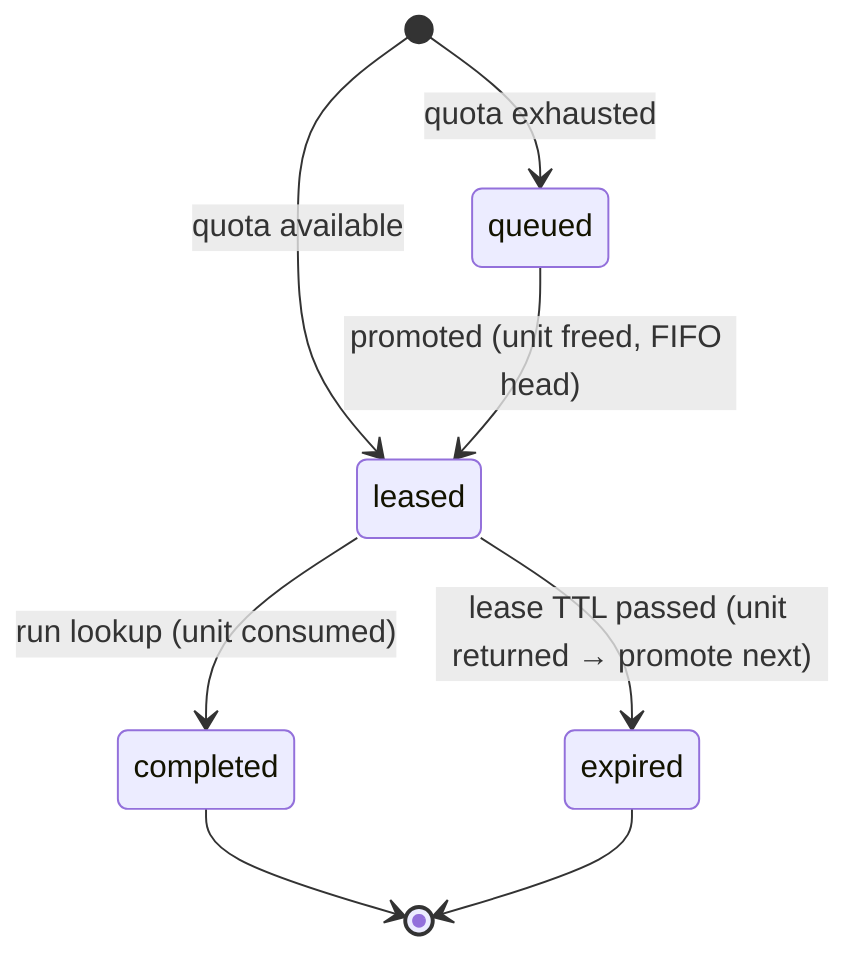

# Chat history

_Auto-generated by `scripts/ai-usage.mjs`. User prompts and assistant replies (tool calls/outputs omitted)._

## Session `bade1a1b-c274-4c22-bb5d-3174badd42e3` (2026-11-09T09:54:42.269Z → 2026-11-09T13:01:41.181Z)

### 🧑 User — 2026-11-09T10:08:53.520Z

go through the document, 

we are going to build this as a monorepo docker+docker-compose, react next on frontend, postgress for db, and laravel for backend
treat this document as source of truth, do not overbuild or overengineering till core requirements are met,  we need to start with simple architecture which must be ready to scale and incremental development. now do following

1. extract the text in an md file
2. initiate repository and push to remote
3. configure project level claude.md file, keep it precise and short and it must follow above instructions
4. setup docker + docker compose use latest stable nodejs and php, build should be optimized with hardened containers, provision volumes where required
5. setup front end and backend apps with static analsis tools, debug tools and type hardening for both PHP and nodejs/TS
6. deploy agents in parallel where required, mind token economics 
7. we need to preserve chat history and prompts as well as token utilization

once done we will start with HLD

### 🤖 Claude — 2026-11-09T10:09:49.885Z

Repo initialised. Launching the two app scaffolds in parallel (Sonnet, to keep cost down) while I do the root config, docs, and history tooling.

### 🤖 Claude — 2026-11-09T10:10:19.027Z

Now the requirements doc, root files, and CLAUDE.md.

### 🤖 Claude — 2026-11-09T10:10:43.973Z

Now the prompt/token tooling. Checking the transcript format first.

### 🤖 Claude — 2026-11-09T10:11:41.461Z

Works. Now the compose files.

### 🧑 User — 2026-11-09T10:14:33.895Z

we need small commits logical commits
before proceeding with commits we need proper git hooks for commit events like pre-commit as well as PR events, build PR templates etc

### 🤖 Claude — 2026-11-09T10:15:16.028Z

Web scaffold done and verified by the agent. Now setting up hooks and PR tooling — checking current action/tool versions first.

### 🤖 Claude — 2026-11-09T10:16:32.628Z

YAML issue (unquoted `: ` in a command). Fixing.

### 🤖 Claude — 2026-11-09T10:16:43.393Z

Hooks installed. Small fixes while the API agent finishes: ignore root `node_modules`, and bump the web app's `@types/node` to 26 (it exists, so it can match the runtime).

### 🤖 Claude — 2026-11-09T10:16:55.302Z

Web checks still pass after the bump. The API scaffold agent is still running; once it reports back I'll verify everything, then make the small logical commits and push.

### 🧑 User — 2026-11-09T10:19:27.488Z

continue or update

### 🤖 Claude — 2026-11-09T10:19:43.805Z

Correction to my last message: I haven't removed any files. I only looked at them. The API agent is still running, and its `prod` and `dev` images built about a minute ago.

The scaffolders added their own agent-instruction files:
- **`apps/web/AGENTS.md`** (from Next.js): a short pointer telling the AI to read the docs bundled with Next 16. I'll keep it, because Next 16 changed a lot.
- **`apps/api/CLAUDE.md` and `apps/api/AGENTS.md`** (from Laravel Boost): long boilerplate guidelines that get loaded whenever work touches `apps/api`, which costs tokens every time. Once the agent finishes, I plan to trim them to a pointer at the root `CLAUDE.md` unless you'd rather keep them.

Everything else is ready to commit:
- **Hooks:** lefthook runs secret scanning (gitleaks), a block on `.env` files, ESLint, Prettier and type checks for the web app, and Pint and Larastan for the API. Commit messages are checked against Conventional Commits, and tests run before each push. The hooks are installed and the config validates.
- **Pull requests:** there's a PR template and a CI workflow for commits and secrets, the web app, the API with Postgres, and the Docker image builds. None of it has run yet, because nothing is pushed.
- **Pushing:** the earlier push was rejected by GitHub's email-privacy protection. I set this repo's git email to your GitHub noreply address and threw away the two local commits so history can be redone in small steps.

When the API agent reports back, I'll check its output, then make roughly 10 small commits (repo basics, docs, AI tooling, hooks, CI, the API scaffold, the web scaffold, compose) and push to the private repo `sumit22/secnix-htask`.

### 🤖 Claude — 2026-11-09T10:21:40.666Z

The API agent's output checks out. Three things to fix before committing:
1. It installed Sanctum (an auth package). The requirements say no authentication, so that's overbuild and I'll remove it.
2. On Windows bind mounts the dev container needs to run as root.
3. The trim of the boilerplate `CLAUDE.md` I mentioned earlier.

### 🤖 Claude — 2026-11-09T10:23:38.924Z

Sanctum is gone, and lint, Larastan max and tests are all green. Now bringing the full stack up to verify the compose setup end to end.

### 🤖 Claude — 2026-11-09T10:24:55.687Z

The dev `api_vendor` volume is shadowing `vendor/` with an empty directory. Checking how the dev image lays it out.

### 🤖 Claude — 2026-11-09T10:25:00.618Z

Simplest fix: in dev, `vendor/` lives in the bind mount and is installed with `composer install` inside the container. That means no extra volume and no stale-dependency trap.

### 🤖 Claude — 2026-11-09T10:26:13.452Z

The dev stack works: migrations ran, `/up` returns 200, and Larastan passes inside compose. Quick check of the hardened prod-like stack on alternate ports:

### 🤖 Claude — 2026-11-09T10:27:37.135Z

Those six went through with the hooks. Now the app commits. PHP files will trigger Pint and Larastan inside the container.

### 🤖 Claude — 2026-11-09T10:28:15.521Z

All hooks passed: secret scan, Pint and Larastan in the container, ESLint, Prettier, typecheck and commitlint. Last commit is the AI-usage snapshot, then the push, which also runs the pre-push tests.

### 🤖 Claude — 2026-11-09T10:28:55.729Z

Pushed: 14 commits, with pre-push tests green. CI has been triggered on `main`, so I'll watch that run before calling this done.

### 🤖 Claude — 2026-11-09T10:29:10.104Z

The setup is pushed to a private repo, https://github.com/sumit22/secnix-htask, as 14 small commits. The dev stack and the hardened prod-like stack both start and pass their health checks. The first CI run on GitHub is still going; I'll report the result when it finishes.

**What's in place**
1. **Requirements:** [docs/requirements.md](docs/requirements.md) holds the full text of the PDF. The PDF itself is gitignored because it's marked confidential.
2. **Repo and history:** the first push was rejected by GitHub's email-privacy protection. I set this repo's git email to your GitHub noreply address (this repo only) and redid the history as small Conventional Commits.
3. **CLAUDE.md:** the [root file](CLAUDE.md) covers source of truth, core-first scope, quota correctness enforced in the database, and the commands. Each app has a short `CLAUDE.md` pointer. I trimmed the long boilerplate Laravel guidelines to save tokens.
4. **Docker:**
   - Versions: Node 26.13, PHP 8.5.12 with FrankenPHP 1.13.5, Postgres 18.6. Every image tag is pinned.
   - Multi-stage builds. Prod containers run as non-root with a read-only filesystem, all Linux capabilities dropped, no privilege escalation, and health checks.
   - [docker-compose.yml](docker-compose.yml) is the prod-like base and [compose.override.yml](compose.override.yml) adds dev bind mounts and debuggers. There are volumes for Postgres data, API storage and the web dependencies.
5. **Apps and tooling:**
   - API: Laravel 13 with Pint, Larastan at its strictest level, `strict_types` in every PHP file, PHPUnit, and Xdebug in the dev image.
   - Web: Next.js 16 with strict TypeScript, type-aware ESLint, Prettier, Vitest, and a Node inspector on port 9229.
6. **Git hooks and PRs:** lefthook runs before commits:
   - Before each commit: gitleaks secret scan, a block on `.env` files, ESLint, Prettier and typecheck for web, Pint and Larastan for the API.
   - On each commit message: commitlint.
   - Before each push: both test suites.
   - On GitHub: a [PR template](.github/pull_request_template.md) and a [CI workflow](.github/workflows/ci.yml) covering commits and secrets, web, the API against Postgres, and the Docker builds.
7. **Parallel agents:** the two app scaffolds ran at the same time on Sonnet to keep cost down, and I checked their work.
8. **Prompts and tokens:** [scripts/ai-usage.mjs](scripts/ai-usage.mjs) runs automatically at the end of every turn. It writes [prompts.md](docs/ai/prompts.md), [chat-history.md](docs/ai/chat-history.md) and [token-usage.md](docs/ai/token-usage.md) from the Claude Code transcripts, including the subagents. So far that's about 5.3M tokens, most of them cache reads.

**What I corrected along the way**
- The API agent installed Sanctum, an auth package. The requirements say no authentication, so I removed it.
- Fixed a dev volume that hid the API's PHP dependencies, a write-permission problem on a temp directory, and a YAML error in the hooks config.

**What you need to know**
- **API PHP files in dev are root-owned:** on Windows bind mounts, the dev API container runs as root so it can write them. Prod runs as a non-root user.
- **First-time setup:** run `npm install` at the repo root to install the hooks, and `cp .env.example .env` to create the local env file. Neither is in a README yet; that's part of the HLD and README work.

Ready to start the HLD.

### 🧑 User — 2026-11-09T10:33:15.454Z

confirm that both apps are ready for development, TDD is setup, use unitest instead of pest in laravel, what about type hardening in php and TS

### 🤖 Claude — 2026-11-09T10:33:21.013Z

Checking the current state of tests and type config in both apps.

### 🤖 Claude — 2026-11-09T10:33:45.933Z

Here's the plan for both apps. It's small, targeted hardening; nothing speculative.

### 🤖 Claude — 2026-11-09T10:34:20.187Z

Web is green: lint, typecheck, format and 4 tests. Now the API: Postgres test database, stricter static analysis, and the Pest cleanup.

### 🤖 Claude — 2026-11-09T10:35:03.617Z

First CI run: all 4 jobs passed. Continuing with the API config:

### 🤖 Claude — 2026-11-09T10:35:17.743Z

Wiring the init script into compose and CI. The existing dev volume already exists, so I'll create the test database there by hand once.

### 🤖 Claude — 2026-11-09T10:35:51.167Z

Strict rules want `self::assert*()` because PHPUnit assertions are static, and they flag the skeleton's `assertTrue(true)` placeholder. Fixing both:

### 🤖 Claude — 2026-11-09T10:36:24.881Z

The test caught a real problem: the tests aren't hitting `app_test`. Let me see which database they actually use.

### 🤖 Claude — 2026-11-09T10:36:41.020Z

Root cause: Docker injects env vars into `$_SERVER`, and Laravel reads `$_SERVER` before `$_ENV`. PHPUnit's `<env force>` only sets `$_ENV` and `putenv`. Adding matching `<server>` entries:

### 🤖 Claude — 2026-11-09T10:38:12.303Z

Pushed, with pre-push tests green. I'm watching the new CI run in the background.

### 🤖 Claude — 2026-11-09T10:38:23.767Z

Both apps are ready for test-first development. Every check passes locally, and the first CI run on `main` passed all 4 jobs. The run for the latest push is still going; I'll report it when it finishes.

**Testing setup**

| | API (Laravel) | Web (Next.js) |
|---|---|---|
| Test framework | PHPUnit 12. Pest is not installed, and I removed a leftover Pest setting from `composer.json`. | Vitest with Testing Library and jest-dom (DOM assertions for tests) |
| Test database | Real Postgres, in a separate `app_test` database | n/a |
| Watch mode | none (PHPUnit has no built-in watch) | `npm run test:watch` |
| One command for lint + types + tests | `composer check` | `npm run check` |
| Tests now | 2: home page responds, tests use the isolated test database | 4: page renders, env config validation |

**A bug the new database test caught:** tests were silently using the dev database. Laravel's test refresh would have wiped your dev data on every run. Docker passes environment variables in a way that overrode the test settings in `phpunit.xml`. I fixed it ([phpunit.xml](apps/api/phpunit.xml)), and [DatabaseTest](apps/api/tests/Feature/DatabaseTest.php) now fails if it ever happens again.

The `app_test` database is created automatically on a fresh database volume ([docker/db/init](docker/db/init/01-test-db.sh)), and CI uses the same setup.

**PHP type hardening**
- Every PHP file starts with `declare(strict_types=1)`, and the formatter (Pint) enforces it.
- PHPStan (static analysis) runs at its strictest level with Larastan for Laravel. I added the strict-rules and deprecation-rules packages and turned on checks for untyped callables and stale ignore rules.
- It now covers `tests/` as well as `app/`, `routes/` and `database/`.
- Pint also enforces strict comparisons, strict parameters, `void` return types and fully qualified type names.

**TypeScript type hardening**
- The compiler runs in `strict` mode plus `noUncheckedIndexedAccess`, `exactOptionalPropertyTypes`, `noImplicitReturns` (new), `noImplicitOverride`, `noUnused*`, `useUnknownInCatchVariables` and `verbatimModuleSyntax`.
- ESLint uses the type-aware strict and stylistic rule sets, which forbid `any`. I added rules requiring `===`, `switch` statements that handle every case, type-only imports, and no unhandled promises.

These checks run before every commit, before every push and in CI. [CLAUDE.md](CLAUDE.md) now has a short TDD section: write the failing test first, and quota and concurrency rules need tests that prove the invariant.

The prompt and token logs in `docs/ai/` update after every turn. I'm leaving them uncommitted and will commit a snapshot at milestones.

### 🧑 User — 2026-11-09T10:39:20.789Z

commit and prepare for next

### 🤖 Claude — 2026-11-09T10:40:16.037Z

Everything is committed and pushed. The working tree is clean and the dev stack is up and healthy.

- **Latest commit:** `98f7f25`, a snapshot of the prompt log, chat history and token usage (7.9M tokens so far, mostly cache reads). That makes 21 small commits on `main`, all of which went through the hooks.
- **CI:** the run for the earlier push hasn't reported yet, and this push started another. I'll report the results when they arrive.
- **Expected change:** `docs/ai/*` will show as modified after each turn, because the end-of-turn script rewrites them. I'll commit them at milestones.

**For the HLD**, I'd focus on the decisions that matter most for the core, roughly in this order:
1. **Data model:** the `quota`, `lookup_requests` (lease state machine) and `queue` tables, and which unique constraints enforce "one active lookup per indicator" and idempotency keys.
2. **Concurrency strategy:** how "never exceed quota" holds with about 200 requests at once. The options are locking the quota row (`SELECT … FOR UPDATE`), a conditional `UPDATE … WHERE remaining > 0`, or advisory locks.
3. **Lease expiry and promotion:** lazy expiry when a request comes in, a scheduler job, or both, and how the oldest queued request gets the freed unit.
4. **API contract:** the endpoints, the status values, and how the idempotency key is sent.
5. **Frontend flow:** polling vs. server-sent events for the queue position and countdown.
6. **Scope cuts:** what goes under "Known limitations".

Tell me when to start, or which of these you want to decide yourself.

### 🤖 Claude — 2026-11-09T10:40:51.440Z

The CI run for `98f7f25` is still in progress, and I'll report its result when it finishes. You can start the HLD now; nothing depends on that run.

### 🤖 Claude — 2026-11-09T10:44:21.088Z

CI passed on `98f7f25`, the latest commit on `main`. All four jobs succeeded: commits and secrets, web, the API against the Postgres test database, and the Docker image builds.

The setup is finished. Ready to start the HLD when you are.

### 🧑 User — 2026-11-09T10:48:26.534Z

When analysts investigate an indicator (an IP, domain or file hash), they 'enrich' it by querying third-party threat intelligence providers for its reputation, related malware families and so on. These integrations are usually rate-limited or quota-limited. Many analysts and automated playbooks ask for lookups at the same time, and a retried request must not burn extra quota.

this paragraph explicitly talks about providers, so we are going to build the platform supporrting multiple providers, each providers may have its own org level quota of services for the platforms

we are building one of those platforms, we need to team level quotas on top of org level quota, but start with one default team for now

Concurrency | Leases and expiry | Queue | Idempotency : these are most important and cant be ignored during implementation

correct me if i am wrong

### 🤖 Claude — 2026-11-09T10:48:49.261Z

You're mostly right. Concurrency, leases and expiry, the queue and idempotency are the core of this problem; the document's tagline lists exactly those four. Multi-provider and team quotas are a fair reading of the domain, but they go beyond what the document asks for. I'd design the schema for them and implement only the minimum.

**Where I agree**
- The background paragraph does describe multiple providers, each with its own plan quota. A real platform would key quotas by provider.
- Concurrency, leases, queue and idempotency can't be simplified away. The document's scope note names the core as request, run, expiry and never exceeding the quota.

**Where I'd push back**
1. **The task specifies one quota.** "Your provider plan has only 10 lookups remaining for today" is one provider and one counter. The document also says "a working, well-understood core is better than extra features", and reviewers will read extra scope against that. Adding `provider_id` and `team_id` columns now costs almost nothing. Building provider registries and team admin would be overbuilding.
2. **Team quotas on top of the org quota conflict with the queue rule.** The requirement says queued requests are "promoted in the order they arrived". Suppose team A has used its share while the org pool still has units. Then team B's newer request should go ahead of A's older queued one, which breaks strict FIFO. That leaves two choices:
   - FIFO within each team, with promotion skipping entries whose team cap is full. This deviates from the literal requirement and needs a note in the README.
   - Strict global FIFO, which makes team caps rarely matter.
   With one default team the conflict never shows, so I'd defer enforcing team caps rather than build logic that can't be exercised yet.
3. **Two-level reservation adds risk.** Each reserve would update the team row and the org row in one transaction, with locks taken in a fixed order to avoid deadlocks. That's doable but doubles the contention surface. I'd add it once a second team exists and can be tested.
4. **Two similar-looking rules are actually distinct.** The HLD should treat them separately:
   - Idempotency key: the same client retrying gets the same response.
   - One active lookup per indicator: a different client asking for the same indicator gets the existing lease or queue entry and spends no new unit.
   Both need unique constraints in the database, not checks in application code.
5. **"For today" implies a daily reset.** I'd store a quota window (period start and end) rather than a bare counter, so a reset is a new row and not a destructive update.

**Recommendation**
- **Schema:** `providers`, `teams` and `quota_allocations` keyed by provider, team (nullable) and period, so it can grow.
- **Implementation:** one mock provider, one seeded default team, and only the org-level quota of 10 per day enforced.
- **Core rules:** concurrency, leases, FIFO queue and idempotency done fully and tested under about 200 parallel requests.
- **README:** a note on the team-quota versus FIFO trade-off as a known extension.

Does that match what you want, or do you want team caps enforced now, with FIFO per team?

### 🧑 User — 2026-11-09T10:52:25.881Z

lets keep it simple but scalable for future, can ji see the db schema you want to propose

### 🤖 Claude — 2026-11-09T10:53:02.370Z

Here's the proposed schema: five tables, with every invariant enforced in Postgres itself. It covers multiple providers and teams, but only the org-level quota is enforced for now.

## Tables

```sql
-- 1. Providers (one mock provider seeded; more later = new rows, no schema change)
providers (
  id          bigserial PK,
  slug        varchar(50)  UNIQUE NOT NULL,   -- 'mock-intel'
  name        varchar(100) NOT NULL,
  created_at, updated_at
)

-- 2. Teams (one 'default' team seeded; used for attribution now, team caps later)
teams (
  id          bigserial PK,
  slug        varchar(50)  UNIQUE NOT NULL,   -- 'default'
  name        varchar(100) NOT NULL,
  created_at, updated_at
)

-- 3. Quota: one row per provider, scope and period (daily window)
quota_allocations (
  id            bigserial PK,
  provider_id   FK providers NOT NULL,
  team_id       FK teams NULL,                -- NULL = org-level pool (enforced now)
  period_start  timestamptz NOT NULL,         -- e.g. today 00:00 UTC
  period_end    timestamptz NOT NULL,
  quota_limit   int NOT NULL,                 -- 10
  reserved      int NOT NULL DEFAULT 0,       -- units held by active leases
  consumed      int NOT NULL DEFAULT 0,       -- units burned by completed lookups
  created_at, updated_at,
  CHECK (reserved >= 0 AND consumed >= 0),
  CHECK (reserved + consumed <= quota_limit),           -- the hard invariant
  UNIQUE NULLS NOT DISTINCT (provider_id, team_id, period_start)
)
-- remaining = quota_limit - reserved - consumed

-- 4. Lookup requests (a lease is a state of the request, not a separate table)
lookup_requests (
  id                uuid PK,                  -- public id for the status endpoint
  provider_id       FK providers NOT NULL,
  team_id           FK teams NOT NULL,
  quota_allocation_id FK quota_allocations NULL,  -- set when a unit is reserved
  analyst_id        varchar(100) NOT NULL,    -- no auth; supplied by the caller
  idempotency_key   varchar(100) NOT NULL,
  request_hash      char(64) NOT NULL,        -- sha256 of payload; same key + different payload → 422
  indicator_type    varchar(10) NOT NULL,     -- ip | domain | hash
  indicator_value   varchar(255) NOT NULL,    -- normalised (lowercased, canonical IP)
  status            varchar(10) NOT NULL,     -- queued | leased | completed | expired
  leased_at         timestamptz NULL,
  lease_expires_at  timestamptz NULL,
  completed_at      timestamptz NULL,
  expired_at        timestamptz NULL,
  result            jsonb NULL,               -- { verdict, score, malware_families[] }
  created_at, updated_at,
  CHECK (status IN ('queued','leased','completed','expired')),
  CHECK (indicator_type IN ('ip','domain','hash')),
  CHECK (status <> 'leased' OR lease_expires_at IS NOT NULL),
  UNIQUE (analyst_id, idempotency_key)                   -- idempotency
)
-- At most one active lookup per indicator, per provider:
CREATE UNIQUE INDEX lookup_requests_one_active_per_indicator
  ON lookup_requests (provider_id, indicator_type, indicator_value)
  WHERE status IN ('queued','leased');
-- Expiry sweep:
CREATE INDEX ON lookup_requests (lease_expires_at) WHERE status = 'leased';

-- 5. Waiting queue (explicit table, as the spec asks)
lookup_queue (
  id                 bigserial PK,             -- arrival order = FIFO order
  provider_id        FK providers NOT NULL,
  lookup_request_id  uuid UNIQUE NOT NULL FK lookup_requests ON DELETE CASCADE,
  enqueued_at        timestamptz NOT NULL DEFAULT now()
)
CREATE INDEX ON lookup_queue (provider_id, id);
-- position = count of rows with the same provider_id and id <= mine
```

## How each rule maps to the schema

| Rule | Enforced by |
|---|---|
| Never exceed quota (~200 concurrent requests) | `SELECT … FOR UPDATE` on the quota row inside a transaction, with the `CHECK (reserved + consumed <= quota_limit)` constraint as a backstop. Even buggy code can't overspend. |
| One active lookup per indicator | The partial unique index. If two requests race, the losing insert fails on the index; we catch that and return the existing request, spending no unit. |
| Idempotent retries | `UNIQUE (analyst_id, idempotency_key)` returns the original request. `request_hash` catches the same key reused with a different payload. |
| FIFO promotion | `lookup_queue.id` order. Promotion takes the head of the queue under row locks, skipping rows another transaction already holds. |
| Lease expiry returns the unit | A sweeper, run by the scheduler every minute plus lazily on reads, moves expired leases to `expired`, decrements `reserved`, and promotes the head of the queue in the same transaction. |
| Run consumes the unit | Lock the request: it must still be `leased` and not past its expiry. Then call the provider, then `reserved -1` and `consumed +1`, and mark it `completed`. |

## Choices worth a second look

- **Status is a `varchar` + `CHECK`, not a Postgres enum.** Adding a state later is a one-line migration.
- **No separate leases table.** A request is leased at most once; when its lease expires, the analyst re-requests. A history table can come later if needed.
- **Expired and completed requests leave the active index.** So the same indicator can be requested again afterwards.
- **Team caps later:**
  - Insert per-team rows into `quota_allocations` and lock both the team row and the org row, always in the same order.
  - Add `team_id` to `lookup_queue` for per-team FIFO.
  - No changes to existing tables.
- **Left out for now:**
  - An audit or events table.
  - Organisations as a table: the platform is single-org, so the org scope is implicit as `team_id IS NULL`.
  - Per-provider indicator-type support.

Two decisions I'd like you to confirm:
1. **Idempotency scope.** I've scoped keys per analyst, `(analyst_id, idempotency_key)`. The alternative is one global scope, which only works if clients generate UUID keys.
2. **What a duplicate indicator returns.** When a second analyst requests an indicator that's already active, I return the existing request, with its lease or queue position and later its result. The alternative is rejecting it with 409.

If this looks right, I'll write it up into `docs/hld.md` together with the API contract and the flows.

### 🧑 User — 2026-11-09T10:56:45.918Z

how this fits with laravel's user models, analysts will be a subclass of that user
we also need to define basic state machines, status definitions, enums, constants etc, some of these will be shared with frontend as well

### 🤖 Claude — 2026-11-09T10:57:26.088Z

Laravel's `users` table becomes the analyst identity. PHP enums are the single source of truth for statuses and other constants, and the TypeScript versions are generated from them so the frontend can't drift. Here's how it fits together.

## 1. Users and analysts

Analysts are a subclass of `User` stored in the same `users` table, with a `role` column telling them apart (single-table inheritance). There's no authentication: the caller passes an analyst id and we check that it exists.

```sql
users (                       -- Laravel default + 2 columns
  id, name, email, password, remember_token, timestamps,   -- password kept (unused, random) so auth can be added later
  role     varchar(20) NOT NULL DEFAULT 'analyst',  CHECK (role IN ('analyst','playbook','admin')),
  team_id  FK teams NOT NULL
)
lookup_requests.analyst_id  →  requested_by  FK users NOT NULL   -- replaces the varchar analyst_id
```

```php
class User extends Authenticatable { /* casts: role => UserRole */ }

final class Analyst extends User
{
    protected $table = 'users';

    protected static function booted(): void
    {
        static::addGlobalScope('role', fn (Builder $q) => $q->where('role', UserRole::Analyst));
        static::creating(fn (self $a) => $a->role = UserRole::Analyst);
    }
}
```

- **Why `playbook` is a role:** the spec says "analysts **and automated playbooks**" request lookups. A playbook is a service account in the same table, so adding a `Playbook` subclass later needs no schema change.
- **Snapshots on the request:** `lookup_requests.team_id` copies the user's team at request time, so quota and history stay correct if the user later changes teams.
- **Idempotency scope** becomes `UNIQUE (requested_by, idempotency_key)`.
- **Seed data:** one `default` team and a few analysts (and one playbook), so the UI can offer an analyst picker without a login screen.

## 2. Lookup state machine



| Status | Active? | Holds a unit? | Meaning |
|---|---|---|---|
| `queued` | yes | no | Waiting in `lookup_queue`; has a position |
| `leased` | yes | reserved | Can run until `lease_expires_at` |
| `completed` | no | consumed | `result` is set |
| `expired` | no | returned | The lease lapsed without a run; the analyst must request again |

- **A failed provider call is not a state.** The request stays `leased` and can be retried within the lease. This matches "a retried request must not burn extra quota".
- **Transitions live in the enum, so code can't skip a step:**

```php
enum LookupStatus: string
{
    case Queued = 'queued';  case Leased = 'leased';
    case Completed = 'completed';  case Expired = 'expired';

    /** @return list<self> */
    public function allowedTransitions(): array
    {
        return match ($this) {
            self::Queued    => [self::Leased],
            self::Leased    => [self::Completed, self::Expired],
            self::Completed, self::Expired => [],
        };
    }
    public function canTransitionTo(self $to): bool { return in_array($to, $this->allowedTransitions(), true); }
    public function isActive(): bool   { return $this === self::Queued || $this === self::Leased; }
    public function isTerminal(): bool { return $this->allowedTransitions() === []; }
}
```

Each transition is a guarded update, so the database refuses a stale move even when two workers race:

```sql
UPDATE lookup_requests SET status = 'completed', …
WHERE id = ? AND status = 'leased' AND lease_expires_at > now();
-- 0 rows affected → the transition is rejected
```

## 3. Enums and constants

| Kind | Name | Values | Shared with frontend |
|---|---|---|---|
| Enum | `LookupStatus` | queued, leased, completed, expired, plus the transition map | ✅ |
| Enum | `IndicatorType` | ip, domain, hash | ✅ |
| Enum | `Verdict` | malicious, suspicious, harmless, unknown | ✅ |
| Enum | `UserRole` | analyst, playbook, admin | ✅ |
| Enum | `ApiErrorCode` | `validation_failed`, `idempotency_key_reused`, `lease_expired`, `lease_not_active`, `not_found`, `analyst_not_found` | ✅ |
| Config | `enrichment.lease_ttl_seconds` | 300 | exposed via the API |
| Config | `enrichment.default_daily_quota` | 10 | exposed via the API |
| Config | `enrichment.quota_period` | `daily`, UTC | ❌ |

- **TTL and quota are config, not constants.** They're read from env, so tests can shorten the TTL to seconds.
- **The frontend gets them at runtime from the API,** not baked into the build.
- **Indicator type is detected server-side when omitted:**
  - Hashes by length: 32, 40 or 64 hex characters (MD5, SHA-1, SHA-256).
  - IP addresses via `filter_var`.
  - Otherwise a domain regex.
  - Values are then normalised: lowercased, canonical IP.

## 4. Sharing with the frontend

PHP enums are the source of truth. An artisan command generates the TypeScript side:

```
php artisan contracts:export   →   apps/web/src/contracts/generated.ts   (committed)
```

```ts
// generated.ts — DO NOT EDIT
export const LookupStatus = { Queued: "queued", Leased: "leased", Completed: "completed", Expired: "expired" } as const;
export type LookupStatus = (typeof LookupStatus)[keyof typeof LookupStatus];
export const LOOKUP_TRANSITIONS: Record<LookupStatus, readonly LookupStatus[]> = { queued: ["leased"], leased: ["completed", "expired"], completed: [], expired: [] };
export const Verdict = { … } as const;  // same pattern for IndicatorType, UserRole, ApiErrorCode
```

- **Drift check:** CI runs the export and `git diff --exit-code`. If someone changes a PHP enum without regenerating, the build fails.
- **Response shapes (DTOs)** are typed by hand in `apps/web/src/contracts/api.ts` for now. When the API grows, swap that for an OpenAPI spec with generated types. That replaces one file and changes nothing in the architecture.
- **Why not a shared `packages/contracts` workspace:** only one consumer exists today, so it would be ceremony. Promote it when a second client appears.
- **Countdown accuracy:** the status response includes `server_time` next to `lease_expires_at`, so the countdown ignores the browser's clock skew.

## Changes from the previous schema

- `analyst_id varchar` becomes `requested_by FK users`.
- `users` gains `role` and `team_id`.
- Idempotency is now unique on `(requested_by, idempotency_key)`.

Everything else stays the same.

If this matches what you had in mind, I'll write `docs/hld.md`: schema, state machine, enums, the contract-sharing approach, API endpoints and the concurrency flows. I'll commit it before writing any code.

### 🧑 User — 2026-11-09T11:00:01.185Z

why bigserial and not ulid or similar

### 🤖 Claude — 2026-11-09T11:00:13.615Z

Let me check what Laravel 13's `HasUuids` generates before answering:

### 🤖 Claude — 2026-11-09T11:00:29.165Z

Good challenge. I'd use time-ordered IDs for anything exposed through the API. The one place I'd keep a database sequence is the FIFO queue, because queue order is the requirement itself. And I'd pick UUIDv7 rather than ULID. I checked that both `Str::uuid7()` (what Laravel 13's `HasUuids` uses) and Postgres 18's native `uuidv7()` are available in this stack.

## UUIDv7 vs ULID

Both are 128-bit and time-sortable. The difference is storage:

| | UUIDv7 | ULID |
|---|---|---|
| Postgres type | native `uuid`, 16 bytes | `char(26)`; Laravel's `ulid()` column is text |
| Index size and comparison speed | small, binary | about 1.6× larger, compared as strings |
| Database can generate it | yes, `uuidv7()` built into Postgres 18 | no native support |
| Laravel support | `HasUuids` (v7 by default) | `HasUlids` |

ULID's only advantage is a shorter string in URLs. That isn't worth giving up the native type.

## Why not UUIDs everywhere

| Table | Proposed ID | Why |
|---|---|---|
| `lookup_requests` | **UUIDv7** | Exposed in `/lookups/{id}` with no authentication, so sequential IDs would let anyone enumerate other analysts' lookups. v7 is time-ordered, so inserts stay cheap on the index, unlike random v4. |
| `users` | **UUIDv7** | The analyst id is sent in every request, so it's exposed too. |
| `providers`, `teams` | **UUIDv7** | Small tables, so the cost is nothing. This gives one consistent public-ID style, and the API refers to them by `slug` anyway. |
| `quota_allocations` | **UUIDv7** | Internal, but consistent. Merging data across regions or tenants later causes no ID collisions. |
| `lookup_queue` | **bigint identity**, internal only | See below. |

## Why the queue keeps a sequence

FIFO promotion is a business rule, so the ordering key has to give a strict total order across all connections.

- **Sequence:** a Postgres sequence hands out strictly increasing numbers across every session. That's a single, unambiguous arrival order even with 200 concurrent inserts.
- **UUIDv7:** it's only monotonic within one connection. Two requests in the same millisecond on different connections get IDs whose order is effectively random. `ORDER BY id` would mostly work but not be guaranteed, and "mostly FIFO" is the bug we'd be asked about in the interview.

So `lookup_queue` keeps a `bigint` identity ID purely as its ordering key. It never leaves the database: the API reports a computed `position`, never the ID.

Neither option captures commit order. Arrival is defined as when the row was inserted, and the HLD will say so.

## Small extras
- **Database default:** UUIDs default to `uuidv7()` in the database as well as being set by Eloquent. Raw SQL inserts, such as the concurrency test harness, then get valid IDs.
- **Laravel's default bigint `users.id`:** I'd change it in the users migration now, while it's still the skeleton. Changing primary keys after foreign keys exist is painful.

Shall I fold this into the schema and write `docs/hld.md`?

### 🧑 User — 2026-11-09T11:02:33.801Z

how we are going to manage queues, for now db queues are fine supported by laravel, but we must support SQS or rabbitMQ

### 🤖 Claude — 2026-11-09T11:03:04.226Z

There are two different queues here, and only one of them can move to SQS or RabbitMQ.

## Two queues, different jobs

| | **Waiting queue** (`lookup_queue` table) | **Job queue** (Laravel Queue) |
|---|---|---|
| What it is | Business state: which requests wait for quota, and in what order | Background work: expiry sweeps, notifications, async calls later |
| Must be transactional with quota | **Yes**: promoting a request and reserving its unit happen in one database transaction | No |
| Needs "what's my position?" | **Yes**, a requirement | No |
| Lives in | **Always Postgres** | database driver now; SQS or RabbitMQ later, by config |

The waiting queue can't live in SQS or RabbitMQ:
- **No positions:** a broker can't answer "position 4 of 7".
- **No shared transaction:** dequeueing a message and reserving quota can't commit atomically. If the app crashes between the two steps, it either leaks a unit or skips a request.
- **Weaker ordering:** SQS standard queues aren't FIFO. SQS FIFO and RabbitMQ only keep order with a single consumer.

So the domain queue stays a table, and the brokers carry jobs that act on it.

## Making the job queue broker-agnostic

Laravel's Queue abstraction already does most of the work:

- **Database driver:** today, `QUEUE_CONNECTION=database`. The `jobs` table already exists from the skeleton.
- **SQS:** built into Laravel. It needs `aws/aws-sdk-php` and `QUEUE_CONNECTION=sqs`.
- **RabbitMQ:** through the community `vladimir-yuldashev/laravel-queue-rabbitmq` package. I'll check it supports Laravel 13 when we add it.

Switching drivers stays a config change only if the jobs follow these rules, which we'd adopt from day one:

1. **Every job is idempotent.** SQS and RabbitMQ deliver at least once, so the same job can run twice. Our guarded state transitions (`UPDATE … WHERE status = 'leased'`) already make a second run do nothing.
2. **Payloads are IDs only.** That keeps us inside broker message-size limits, and a job always reads fresh state from the database.
3. **No correctness depends on the broker.** Order comes from `lookup_queue.id`, and expiry comes from `lease_expires_at`. If a job is late, lost or duplicated, the system stays correct; it's just slower to free a unit.
4. **Jobs are dispatched after commit.** We set `after_commit: true` on every connection. Otherwise a job sent to SQS could run before the transaction that created its data commits. A transactional outbox, which guarantees an event survives a crash after commit, isn't needed until we publish events that must never be lost.
5. **No long delays.** SQS caps delays at 15 minutes, and RabbitMQ needs a plugin for delays. We use the scheduler rather than long-delayed jobs.

## What runs on it in the core

| Job | Trigger | Notes |
|---|---|---|
| `SweepExpiredLeases` | Scheduler, `everyTenSeconds()` | Expires leases, returns units and promotes the head of the queue in one transaction. `FOR UPDATE SKIP LOCKED` lets several workers run it in parallel safely, and `WithoutOverlapping` avoids wasted runs. |
| Lazy expiry | Inline on reserve and status reads | Users never see a stale lease, even if the worker is down. |

**Run lookup** stays synchronous: the user clicks and gets the result. Making it async for playbooks later becomes a `RunLookup` job, with no change to the schema or the state machine.

**Docker** gets two more services from the same API image, each running a different command:
- `worker`: `php artisan queue:work`, which scales horizontally.
- `scheduler`: `php artisan schedule:work`, exactly one replica.

**Testing:** the sweeper is tested by calling it directly with a frozen clock, so tests never wait for a queue.

## Where this leaves the stack

- **Now:** Postgres holds the business data, the waiting queue and the Laravel job queue.
- **Later:** swap the job queue to SQS or RabbitMQ by config only. The waiting queue and quota stay in Postgres no matter what, since that's where the "never exceed quota" guarantee lives.

Shall I write all of this up as `docs/hld.md`? That would cover the schema with UUIDv7, users and analysts, the state machine, enums and contract sharing, the API, the concurrency flows and this queue design.

### 🧑 User — 2026-11-09T11:05:47.892Z

okay start dev with TDD, models migrations, config and other things as discussed above first

### 🤖 Claude — 2026-11-09T11:06:01.458Z

Starting with a compact `docs/hld.md` so the decisions we just made are recorded, then the foundation using TDD. Let me look at the skeleton files I'll be changing.

### 🤖 Claude — 2026-11-09T11:06:05.439Z

First the HLD, recording the agreed decisions:

### 🤖 Claude — 2026-11-09T11:06:32.838Z

HLD committed. **TDD cycle 1: enums and the indicator normalizer.** These are pure logic, so I'm writing the tests first.

### 🤖 Claude — 2026-11-09T11:07:03.439Z

Both suites fail as expected (red). Now the implementation:

### 🤖 Claude — 2026-11-09T11:07:39.102Z

Green: 27 tests pass. Committing as two commits, which also runs Pint and Larastan in the hooks:

### 🤖 Claude — 2026-11-09T11:08:03.115Z

**TDD cycle 2: schema.** The tests write to the tables with raw `DB::table` inserts, deliberately bypassing app code. The point is to prove Postgres itself enforces every invariant.

### 🤖 Claude — 2026-11-09T11:08:40.564Z

Red: 13 failing. Now the migrations:

### 🤖 Claude — 2026-11-09T11:09:27.949Z

All 13 pass on the first run. Checking that every migration rolls back cleanly (the HLD requires reversible migrations), and running static analysis:

### 🤖 Claude — 2026-11-09T11:10:26.450Z

Clean. Committing the schema:

### 🤖 Claude — 2026-11-09T11:10:47.018Z

**TDD cycle 3: config, models, factories and seeder.** Tests first:

### 🤖 Claude — 2026-11-09T11:11:28.222Z

Red: 13 failing. Now config, the models, factories and the seeder:

### 🤖 Claude — 2026-11-09T11:12:13.168Z

Now the factories and the seeder:

### 🤖 Claude — 2026-11-09T11:12:58.361Z

All 55 tests pass. Running PHPStan and Pint before committing:

### 🤖 Claude — 2026-11-09T11:14:41.907Z

The dev database is seeded with 10 units and 3 analysts. Committing in three logical steps:

### 🤖 Claude — 2026-11-09T11:15:28.119Z

Red. Implementing the command:

### 🤖 Claude — 2026-11-09T11:16:33.383Z

Green, and PHPStan is clean. Now I'll generate the file, add a root script, and add the CI drift check:

### 🤖 Claude — 2026-11-09T11:16:48.164Z

The generated file typechecks and lints. Adding the CI drift check to the API job:

### 🤖 Claude — 2026-11-09T11:18:01.779Z

The foundation layer is in place, built test-first: tables, models, enums, config, seed data and the shared frontend contracts. All 58 API tests pass, PHPStan reports no errors, and it's pushed as 15 small commits. CI on GitHub is still running for this push; I'll tell you the result when it lands.

**What exists now**
- **Design doc:** [docs/hld.md](docs/hld.md) records everything we agreed (schema, state machine, concurrency, queues).
- **Enums:** `LookupStatus` holds the state machine: allowed transitions, `isActive`, `isTerminal`. There are also `IndicatorType`, `Verdict`, `UserRole` and `ApiErrorCode`.
- **Indicator normalizer:** detects IP, domain or hash and normalises the value. For example, `Example.COM` and `example.com` count as the same indicator.
- **Database tables:** teams, users, providers, quota allocations, lookup requests and the waiting queue. All IDs are UUIDv7, except the queue's ordering column.
- **Rules the database enforces:**
  - Quota can't be over-allocated, and counters can't go negative.
  - Only one org-level quota row per provider per day.
  - The idempotency key is unique per requester.
  - An indicator can have only one queued or leased lookup at a time.
  - Status and role values are restricted to the allowed lists, and a leased request must have an expiry time.

  [SchemaConstraintsTest](apps/api/tests/Feature/Database/SchemaConstraintsTest.php) proves each rule by writing straight to the tables, bypassing the app. All migrations also roll back cleanly.
- **Models:** `Analyst` is a subclass of `User`, filtered to the analyst role. `ensureOrgAllocation()` creates each UTC day's quota row and is safe under concurrent calls.
- **Seed data:** a default team, the mock provider, 3 analysts, 1 playbook account and today's quota of 10. It's safe to run on every deploy.
- **Config:** `config/enrichment.php` holds the lease length (300 s), the daily quota (10) and the default provider, all settable via environment variables. Queued jobs are only sent once their database transaction commits.
- **Shared with the frontend:** `php artisan contracts:export` generates [generated.ts](apps/web/src/contracts/generated.ts) from the PHP enums. Rerun it with `npm run contracts:export` after changing an enum; CI now fails if the TypeScript file is out of date.

**Corrections along the way**
- **Static-analysis rule switched off:** PHPStan's strict rules flagged every database query call in models and tests as an error. That's a known false positive with Laravel, so I turned off that one rule in [phpstan.neon](apps/api/phpstan.neon), with a comment explaining why.
- **Seeder:** I removed the Laravel skeleton's setting that disables model events, because it would have bypassed the step that forces new analysts to the analyst role.

**Next:** the core flows, test-first: request (reserve or queue), run, expiry and promotion, ending with a test that fires about 200 concurrent requests and proves the quota is never exceeded.

### 🤖 Claude — 2026-11-09T11:19:37.938Z

CI passed on GitHub for the foundation push: commits and secrets, web, the API, and the Docker image builds. The API job includes the new check that the shared TypeScript contracts match the PHP enums.

Next are the core flows: request, run, expiry and promotion, ending with the test that fires about 200 concurrent requests.

### 🧑 User — 2026-11-09T11:21:52.069Z

ensure to have precise but minimal commnets are present
though its small app i want to restrucutre in modules with strict module boundaries

Laravel/eloquent do not provide inbuilt repositories, but we are going to build this with services and service interfaces to as per solid principles, 12 factor app

we missed this and this is right time to course correct

identify core service classes and interfaces, ask atomic questions where required or you are blocked

### 🤖 Claude — 2026-11-09T11:22:41.256Z

Good time to correct course: the foundation code is small and fully covered by tests, so a restructure is cheap now. Here's my proposed module layout; three decisions need your call before I touch any code.

## Proposed modules

```
app/
  Modules/
    Shared/      Clock, TransactionRunner, ApiErrorCode, base DomainException
    Identity/    Team, User, Analyst, UserRole            → exposes RequesterDirectory
    Providers/   Provider, Verdict, MockThreatIntel       → exposes ThreatIntelProvider, ProviderCatalog
    Quota/       QuotaAllocation                          → exposes QuotaLedger
    Lookups/     LookupRequest, LookupQueueEntry, LookupStatus, IndicatorType, IndicatorNormalizer
                 → exposes the use cases below
  Console/       composition root (contracts:export reads enums from every module)
```

Each module follows the same layout:
- `Contracts/` holds the public interfaces and DTOs, and is the only part other modules may import.
- `Domain/` holds models, enums and value objects.
- `Application/` holds services.
- `Infrastructure/` holds the Eloquent and provider implementations.
- `Http/` holds controllers, requests and resources.
- A `ModuleServiceProvider` binds the interfaces and loads the module's routes.

**Dependency direction:** `Lookups → {Identity, Providers, Quota}.Contracts → Shared`. Nothing depends on `Lookups`.

## Core interfaces

| Module | Interface | Responsibility |
|---|---|---|
| Shared | `Clock` | `now(): CarbonImmutable`. It's injected rather than calling `now()` directly, so expiry tests can use a frozen clock. |
| Shared | `TransactionRunner` | `run(callable)` wraps `DB::transaction`. This is how modules share one transaction without seeing each other's internals. |
| Identity | `RequesterDirectory` | `find(id): ?Requester`, returning a DTO of `{id, teamId, role}`. `Lookups` never touches `User`. |
| Providers | `ThreatIntelProvider` | `lookup(Indicator): ProviderResult`, returning verdict, score and malware families. `MockThreatIntelProvider` returns a random verdict. |
| Providers | `ProviderCatalog` | Resolves a slug to `ProviderRef{id, slug}` and returns the provider's client. |
| Quota | `QuotaLedger` | `tryReserve(providerId, at): ?allocationId` (row lock), `release(allocationId)`, `consume(allocationId)`, `snapshot(providerId, at): QuotaSnapshot`. It must be called inside the caller's transaction. |
| Lookups | `RequestEnrichment` | Reserve or queue the request. Handles idempotency and duplicate indicators. |
| Lookups | `RunLookup` | Check the lease is still valid, call the provider, consume the unit. |
| Lookups | `ExpireLeases` | Sweep expired leases, return their units and promote the next queued request. |
| Lookups | `LookupStatusQuery` | Returns a `LookupView` with the queue position and `server_time`. |
| Lookups (internal) | `WaitingQueue` | `enqueue`, `claimHead` (with `SKIP LOCKED`), `positionOf`. |

`IndicatorNormalizer` stays a concrete class. It's pure logic with no second implementation, and an interface would only add ceremony.

**12-factor gaps this closes:**
- An injected `Clock`.
- Separate `worker` and `scheduler` process types, added with the expiry work.
- Backing services attached purely through config.

Config, stderr logs, stateless containers and one-off migrate/seed admin processes are already in place.

**Decided without asking:**
- Migrations stay central in `database/migrations`, because there are cross-module foreign keys and the run order matters.
- Factories move into their modules.
- Modules live under `app/Modules`, so no composer autoload changes are needed.
- I'll trim comments to precise one-liners as I move each file.

### 🤖 Claude — 2026-11-09T11:24:37.957Z

`deptrac/deptrac` 4.7.2 is the maintained package; `qossmic/deptrac` is abandoned. First the mechanical part: `git mv`, so file history is kept, plus namespace rewrites.

### 🤖 Claude — 2026-11-09T11:25:49.184Z

Those IDE diagnostics are from the previous version of the file, before I removed the `provider` relation. Next, `LookupRequest`: I'm removing its cross-module relations and keeping the ID columns.

### 🤖 Claude — 2026-11-09T11:26:05.636Z

Next I'll update the seeder to use the repository, and split the model tests to match the new module structure.

### 🤖 Claude — 2026-11-09T11:26:10.775Z

Now the tests: the quota tests move into the Quota module and go through the repository, and the Lookups test drops the relations that crossed module lines.

### 🤖 Claude — 2026-11-09T11:27:40.234Z

The imports are simply missing (the class-path replacement didn't match), and Pint then removed the unused `QuotaAllocation` import from the seeder. Fixing with direct edits:

### 🤖 Claude — 2026-11-09T11:28:09.678Z

Shell escaping of backslashes keeps failing, so I'm using the Edit tool directly:

### 🤖 Claude — 2026-11-09T11:29:05.622Z

All 57 tests pass and PHPStan is clean; those IDE diagnostics are from before the edits. Now **Deptrac**, to enforce the module boundaries:

### 🤖 Claude — 2026-11-09T11:30:28.295Z

No violations. "Uncovered" counts framework and vendor classes, which belong to no module. To be sure the rules actually bite, I'll plant a deliberate violation and confirm Deptrac catches it:

### 🤖 Claude — 2026-11-09T11:30:38.219Z

Deptrac catches it: `Lookups` must not depend on `Identity` internals. Now I'll wire it into the composer `check` script, the pre-commit hook and CI:

### 🤖 Claude — 2026-11-09T11:31:26.482Z

The comments are mostly one-line "why" notes. I'll trim the few that are wordy, inaccurate or boilerplate:

### 🤖 Claude — 2026-11-09T11:32:33.653Z

The full check is green. Next I'm recording the module structure in the HLD and CLAUDE.md:

### 🤖 Claude — 2026-11-09T11:33:01.383Z

One stale reference in CLAUDE.md: enums no longer live in `app/Enums`. Fixing it, then pushing:

### 🤖 Claude — 2026-11-09T11:33:52.916Z

The API is now split into five modules with strict boundaries, and a tool checks those boundaries automatically. All 57 tests still pass, and lint, static analysis and the boundary check (Deptrac) are clean. It's pushed; CI is still running and I'll report when it finishes.

**What changed**
- **Modules:** `app/Modules/{Shared, Identity, Providers, Quota, Lookups}`. Each has `Contracts/` (public interfaces, DTOs and enums), `Domain/` (models and repository interfaces), `Infrastructure/` (Eloquent repositories) and its own factories. A module service provider is added once it has something to bind; so far only Quota has one. File moves were done with `git mv`, so history is kept.
- **References by ID only across modules:** `LookupRequest` no longer has `provider`, `team`, `requester` or `quotaAllocation` relations. The ID columns and the database foreign keys stay.
- **First repository:** `QuotaAllocationRepository` (interface) with `EloquentQuotaAllocationRepository`, bound in `QuotaServiceProvider`. The old static `ensureOrgAllocation` method moved into it, and the seeder now receives the repository through injection.
- **Boundary enforcement:** [deptrac.yaml](apps/api/deptrac.yaml) allows a module to import only its own code, `Shared`, and other modules' `Contracts`. I planted a deliberate violation to check it gets caught, and it did. Deptrac runs in `composer check`, the pre-commit hook and CI.
- **Comments:** tightened to one-line "why" notes, and the Laravel boilerplate comments are removed. The rule is now in CLAUDE.md.
- **Docs:** the HLD has a module section: what each module owns, its public interfaces, the dependency direction, how a transaction spans modules, and the 12-factor points.

**One placement decision of mine:** the indicator value object and normalizer went into `Shared`. Providers needs the indicator to call a provider, Lookups needs it to deduplicate, and neither may import the other.

**What's next, test-first.** Each flow brings its interfaces with it, so nothing is written speculatively:
1. The quota ledger (`QuotaLedger`) for reserve, release, consume and snapshot, plus `Clock` and `TransactionRunner` in Shared.
2. `RequesterDirectory` in Identity and `ThreatIntelProvider` with the mock provider in Providers.
3. In Lookups: request enrichment, run lookup, lease expiry with promotion, and the status query. Then the test with about 200 concurrent requests.

### 🧑 User — 2026-11-09T11:34:28.936Z

okay lets discuss all the API endpoints and respective contracts

### 🤖 Claude — 2026-11-09T11:35:15.613Z

Here's the proposed API: five endpoints under `/api/v1`, with request and response shapes. Designing them exposed one real gap in the current schema (point 3), and there are four questions at the end.

## Endpoints

| # | Method and path | Purpose | Success |
|---|---|---|---|
| 1 | `POST /api/v1/lookups` | Request enrichment: reserve a lease or join the queue | `201` new · `200` replay or duplicate indicator |
| 2 | `POST /api/v1/lookups/{id}/run` | Run the lookup: call the provider and consume the unit | `200` |
| 3 | `GET /api/v1/lookups/{id}` | Status of one lookup: lease countdown, queue position, result | `200` |
| 4 | `GET /api/v1/quota` | Dashboard: remaining units, reserved, consumed, queue length | `200` |
| 5 | `GET /api/v1/analysts` | Analyst picker for the UI, since there's no login | `200` |

There's no mock provider endpoint: the provider is an in-process `ThreatIntelProvider` implementation, which the spec allows ("a function or endpoint"). `/up` is the health check.

## Common rules
- **Who is calling:** an `X-Analyst-Id: <uuid>` header on every call (question 1). If it's unknown: `422 analyst_not_found`.
- **Envelopes:**
  - Success: `{ "data": … }`
  - Error: `{ "error": { "code": ApiErrorCode, "message": string, "fields"?: { name: [msg] } } }`
- **Clock skew:** every response carries `server_time`, so the countdown doesn't depend on the browser's clock.

## 1. `POST /api/v1/lookups`
```http
Idempotency-Key: 3f1c…            (required, ≤100 chars)
X-Analyst-Id: 019a…
{ "indicator": "Evil.Example.com", "indicator_type": "domain" | null, "provider": "mock-intel" | null }
```

| Case | Status | Body |
|---|---|---|
| Quota free | `201` + `Location` | `LookupView` with status `leased` |
| Quota exhausted | `201` + `Location` | `LookupView` with status `queued` and a position |
| Same key, same payload (retry) | `200` + `Idempotent-Replayed: true` | the current `LookupView`; no unit spent |
| Same key, different payload | `422 idempotency_key_reused` | |
| Indicator already active (anyone's request) | `200`, `"deduplicated": true` | the existing `LookupView`; no unit spent |
| Missing key | `400 idempotency_key_missing` | |
| Invalid indicator or provider | `422 validation_failed` | |

## 2. `POST /api/v1/lookups/{id}/run`
This call is naturally idempotent, so it needs no idempotency key: once a lookup is completed, calling run again just returns the stored result.

| Case | Status |
|---|---|
| Leased and not yet expired | `200`, status `completed` with `result` |
| Already completed | `200`, the same result; no second unit |
| Lease expired | `409 lease_expired` |
| Still queued | `409 lease_not_active` |
| Provider failure | `503 provider_unavailable` + `Retry-After`; the lease is kept, so the run can be retried |
| Caller may not run it | `403 forbidden` (question 2) |
| Unknown id | `404 not_found` |

## 3. `GET /api/v1/lookups/{id}` returns a `LookupView`
```jsonc
{
  "id": "019a…", "status": "queued|leased|completed|expired",
  "indicator": { "type": "domain", "value": "evil.example.com" },
  "provider": "mock-intel", "requested_by": "019a…", "deduplicated": false,
  "lease":  { "leased_at": "…", "expires_at": "…" } | null,
  "queue":  { "position": 3 } | null,                      // 1 = next in line
  "result": { "verdict": "malicious", "score": 87, "malware_families": ["Emotet"], "looked_up_at": "…" } | null,
  "created_at": "…", "completed_at": null, "expired_at": null,
  "server_time": "…"
}
```
If a lease has passed its expiry time, the response shows `expired` straight away, without waiting for the background sweep.

## 4. `GET /api/v1/quota?provider=mock-intel`
```jsonc
{ "provider": "mock-intel", "period": { "start": "…", "end": "…" },
  "limit": 10, "reserved": 2, "consumed": 5, "remaining": 3, "queued": 4,
  "lease_ttl_seconds": 300, "server_time": "…" }
```

## 5. `GET /api/v1/analysts`
Returns `[{ "id", "name", "team": { "id", "slug" } }]`.

## New error codes
`idempotency_key_missing`, `provider_unavailable` and `forbidden` get added to `ApiErrorCode`. The TypeScript side regenerates automatically.

## The gap in the current schema
Idempotency keys are currently stored on `lookup_requests`, and that breaks in one case:
1. Analyst B requests `evil.com` while A's lookup for it is active. B gets A's lookup back, and nothing is stored for B's key.
2. A's lookup completes.
3. B's client retries with the same key. Nothing matches it any more, so a new lookup is created and **a second unit is spent**. That violates "a retried request must not burn extra quota".

The fix is a separate `idempotency_keys` table: `(requested_by, key)` unique, plus `request_hash` and `lookup_request_id`. Every request records its key, including deduplicated ones, so a retry always returns the lookup it was originally given. The two columns come off `lookup_requests`. It's a small migration change, and we're still pre-release.

### 🤖 Claude — 2026-11-09T11:39:17.593Z

Before handing off the UI, I'll add the new error codes, so the generated TypeScript the agent builds against is complete:

### 🤖 Claude — 2026-11-09T11:40:56.110Z

The UI agent is working in the background. I'm building the backend now; first a look at the routing bootstrap.

### 🤖 Claude — 2026-11-09T11:40:59.879Z

**Step 1: the `idempotency_keys` table.** It's pre-release, so I'm editing the lookup migration in place rather than stacking a corrective migration:

### 🤖 Claude — 2026-11-09T11:41:13.081Z

Updating the schema tests to target the new table:

### 🤖 Claude — 2026-11-09T11:41:42.394Z

All 57 tests still pass. Committing, then on to the module services.

### 🤖 Claude — 2026-11-09T11:42:05.864Z

**Step 2: Shared kernel, Identity, Providers and Quota services.** Each one is an interface in `Contracts`, with a repository behind it.

### 🤖 Claude — 2026-11-09T11:42:17.000Z

Now Identity: `Requester`, `RequesterDirectory` and the `X-Analyst-Id` middleware.

### 🤖 Claude — 2026-11-09T11:42:34.016Z

Now Providers: the provider catalog, the `ThreatIntelProvider` contract and the mock provider.

### 🤖 Claude — 2026-11-09T11:42:55.393Z

Now Quota: `QuotaLedger`. Every change to a counter is a single atomic `UPDATE`, with the Postgres CHECK constraint as a backstop.

### 🤖 Claude — 2026-11-09T11:45:14.349Z

65 tests pass and PHPStan is clean. I'll commit one module at a time; `bootstrap/providers.php` grows with each commit, so every commit stays green.

### 🤖 Claude — 2026-11-09T11:45:23.943Z

Shell backslash escaping again. I'll write a small Node helper instead:

### 🤖 Claude — 2026-11-09T11:45:47.730Z

The four module commits are in. Next I'm verifying the agent's web UI myself before committing it:

### 🤖 Claude — 2026-11-09T11:47:11.058Z

Next, the Lookups domain: the `IdempotencyKey` model and the repository interfaces.

### 🤖 Claude — 2026-11-09T11:48:16.073Z

Now the Lookups application services: lease manager, view factory and the four use cases.

### 🤖 Claude — 2026-11-09T11:48:48.087Z

Two simplifications: the request hash should have a single source, and `lease()` can always go through the transition guard.

### 🤖 Claude — 2026-11-09T11:49:24.217Z

Now the Lookups HTTP layer, the sweeper job and the service provider:

### 🤖 Claude — 2026-11-09T11:49:54.347Z

The config values should be read when a service is resolved, not when it's registered, so tests can override them:

### 🤖 Claude — 2026-11-09T11:50:15.139Z

I left some junk in that bootstrap file: a wrong `statefulApi` call, an unnecessary `unset`, and an unused import. Rewriting it cleanly:

### 🤖 Claude — 2026-11-09T11:51:11.005Z

Now the integration tests, covering every branch in docs/api.md. They run over HTTP against real Postgres, and they're also the first exercise of the Lookups code.

### 🤖 Claude — 2026-11-09T11:52:21.266Z

My helper named `run()` collides with PHPUnit's own `final run()` method. Renaming it:

### 🤖 Claude — 2026-11-09T11:55:35.121Z

All four concurrency tests pass. Now the full gate (tests, PHPStan, Deptrac), then commits:

### 🤖 Claude — 2026-11-09T11:57:53.831Z

All 98 tests pass. Two PHPStan nits remain: my script swallowed the backslashes in a docblock type, and one closure signature. Fixing with Edit:

### 🤖 Claude — 2026-11-09T11:59:02.213Z

The sed import edit didn't apply, so I'll add it with Edit:

### 🤖 Claude — 2026-11-09T11:59:39.721Z

Everything is clean: 98 tests, PHPStan, Deptrac. Committing the Lookups work in logical steps:

### 🤖 Claude — 2026-11-09T12:00:19.271Z

I'm adding an `api-env` YAML anchor so the API, worker and scheduler share one environment, then defining the two new process types:

### 🤖 Claude — 2026-11-09T12:01:20.876Z

All five services are up and the scheduler is running. Next, a smoke test over real HTTP: the lookup flow, a CORS preflight and a disallowed origin.

### 🤖 Claude — 2026-11-09T12:03:55.883Z

While both agents run, I'm writing the test matrix that maps each requirement to its execution paths and to the tests that cover them, starting with the API side.

### 🤖 Claude — 2026-11-09T12:04:19.385Z

While the agents work, I'll draft the README. It's a required deliverable, covering the design rationale, how to run and deploy, limitations, and the AI-usage notes.

### 🤖 Claude — 2026-11-09T12:05:09.764Z

The README and test matrix are committed. The audit agent and the Playwright agent are both still running; I'll triage the audit findings and run the Playwright suite as soon as they report.

### 🧑 User — 2026-11-09T12:05:23.385Z

Business rules
The system must never allow more lookups than the quota, even under about 200 simultaneous requests
An indicator can have at most one active lookup (leased or queued) at a time. Requests for the same indicator should not consume additional quota.
If a client retries a request with the same idempotency key, it must not consume a second unit
When no quota is available, requests are queued and promoted in the order they arrived
Scope note
Time is limited. A working core (request, run, expiry, never exceed quota) matters more than a complete feature set. Decide what to prioritise and document what you chose to leave out.Business rules
The system must never allow more lookups than the quota, even under about 200 simultaneous requests
An indicator can have at most one active lookup (leased or queued) at a time. Requests for the same indicator should not consume additional quota.
If a client retries a request with the same idempotency key, it must not consume a second unit
When no quota is available, requests are queued and promoted in the order they arrived
Scope note
Time is limited. A working core (request, run, expiry, never exceed quota) matters more than a complete feature set. Decide what to prioritise and document what you chose to leave out.

confirm that we are aligned, and core is ready

### 🤖 Claude — 2026-11-09T12:05:37.306Z

Yes, we're aligned and the core is ready. Each business rule is enforced in the database, so a bug in application code can't break it, and each one has passing tests. Two things are still open: the independent audit and the Playwright end-to-end tests are still running, so I'll report their results before calling it final.

| Rule | How it's enforced | Evidence |
|---|---|---|
| **Never more lookups than the quota, even with ~200 simultaneous requests** | Every reservation waits on the provider's quota-row lock (`SELECT … FOR UPDATE`). Postgres also rejects any overspend with `CHECK (reserved + consumed <= quota_limit)`, and counters only change through atomic `UPDATE`s. | 60 forked processes, each with its own DB connection: exactly 10 leased, 50 queued. **200 simultaneous HTTP requests: exactly 10 leased, 152 queued, 0 errors.** A test also shows the database refusing an over-reservation directly. |
| **One active lookup per indicator, no extra quota** | A partial unique index allows one `queued` or `leased` lookup per indicator, checked after the lock. Indicators are normalised first, so `Example.COM.` and `example.com` count as the same one. | 60 processes on the same indicator → 1 lookup, 1 unit. In the load test, 20 hits on one indicator → 1 lookup plus 19 duplicates. Integration test: a second analyst gets `deduplicated: true` with no unit spent. |
| **Retry with the same idempotency key never spends a second unit** | `idempotency_keys` is unique per requester and key, and records deduplicated requests too. Same key with a different payload → 422. | 60 processes with one key → 1 lookup, 1 unit. Load test: 20 retries → 1 lookup plus 19 replays. Integration test: retrying a deduplicated request after it completed still spends no unit (the gap we closed). |
| **Queued when no quota, promoted in arrival order** | `lookup_queue` ordered by a database sequence. Freed units go to the queue head first, and a new request can't jump a non-empty queue. | Integration tests cover FIFO positions, sweeper promotion order, and "no queue jumping". |

**The core flows in the scope note:**
- **Request:** leased → 201; queued → 201 with a position; replay or duplicate → 200; every error code has a test.
- **Run:** consumes exactly one unit. A second run returns the same result, and concurrent runs still consume only one unit. If the provider fails, the lease is kept for a retry.
- **Expiry:** an overdue lease returns its unit and promotes the next queued request. Three triggers share the same code path: the scheduler sweep every 10 s, lazily on any read or request, and on run.
- **Totals:** 98 API tests, 25 web tests, PHPStan at max, Deptrac clean, CI green on the last push.

**What we chose to leave out** is listed in the README under known limitations:
- Authentication: the caller is identified by the `X-Analyst-Id` header.
- Team-scoped reads.
- Enforcing team-level quota caps (the schema already supports them).
- Push updates: the UI polls.
- Rate limiting, and a retention policy for idempotency keys.

**Still pending:**
- **Audit:** the independent reviewer may flag something.
- **Playwright:** the end-to-end suite will exercise the real UI paths, including lease expiry and promotion with a short test lease.

I'll fix anything the audit finds and report both results before calling it final.

### 🤖 Claude — 2026-11-09T12:08:31.577Z

The audit is back, and I need to correct what I told you a moment ago. Two findings are real gaps in edge cases of the core rules I said were covered:
1. **Deadlock, high:** a run in flight, plus a second analyst requesting the same indicator, can deadlock in Postgres. If the run is the side that gets cancelled, the retry calls the provider again, so real provider quota is spent twice.
2. **Midnight UTC, high:** leases taken just before midnight stay valid after it, while the new day's allocation hands out a fresh 10 units. Up to 20 provider calls could land on one day against a limit of 10.

Both pass every current test, because no test covers those interleavings. I'll fix them test-first, starting with tests that reproduce each problem, along with the cheap medium-severity findings. Here's the plan:

| # | Finding | Action |
|---|---|---|
| 1 | Deadlock between run and a deduplicated request | Run locks with `FOR NO KEY UPDATE` instead of `FOR UPDATE`, which no longer conflicts with the foreign-key check the dedup insert does. Test reproduces it with a slow provider. |
| 2 | Midnight double-spend | Cap `lease_expires_at` at the allocation's `period_end`. |
| 3 | Non-domain provider exceptions return 500 | Map them to `503 provider_unavailable` with `Retry-After`. |
| 5 | Unvalidated query params cause 500s; 405 and other errors skip the envelope | Validate `requested_by`, `status` and `provider`; add a catch-all JSON error renderer. |
| 6 | `APP_DEBUG=true` leaks into prod-like runs | `.env.example` defaults to production with debug off; the dev override turns debug on explicitly. |
| 8 | Every dashboard poll takes the quota lock | Lock only when there's a due lease or a waiting request. |
| 9 | Concurrent same-key requests to different providers, or straddling midnight, get a 500 on a unique violation | Retry the transaction once; the re-read finds the existing row. |
| 10 | IPv4-mapped IPv6 and Unicode domains not normalised | Fold `::ffff:a.b.c.d` to IPv4; convert Unicode domains to punycode. |
| 4, 7, 11, 12 | Unscoped reads, unbounded queue, minor UI issues, doc drift | Document under known limitations, and fix the doc drift. |

Red tests first:

### 🤖 Claude — 2026-11-09T12:09:07.136Z

The deadlock test fails as expected (red). Checking that it fails for the right reason:

### 🤖 Claude — 2026-11-09T12:10:05.079Z

It isn't red for the right reason yet: the test's `use` imports didn't get added, so it fails on a missing class. Adding them:

### 🤖 Claude — 2026-11-09T12:10:40.933Z

The waiting-queue claim deletes its row, and a delete needs a full `FOR UPDATE`, so that one stays. The other four sites switch to `FOR NO KEY UPDATE`:

### 🤖 Claude — 2026-11-09T12:11:22.484Z

Green: all five concurrency tests pass, including the deadlock reproduction. Committing that fix, then the midnight boundary:

### 🤖 Claude — 2026-11-09T12:11:34.668Z

**Midnight boundary.** First a test asserting that a lease never outlives its quota day. At no instant may more than `limit` leases be live.

### 🤖 Claude — 2026-11-09T12:12:01.441Z

Red, as expected: the lease ran to 00:03, past midnight. The fix is to cap each lease at its allocation's `period_end`.

### 🤖 Claude — 2026-11-09T12:13:29.601Z

Same missing-import problem as before. Adding it with Edit:

### 🤖 Claude — 2026-11-09T12:15:20.154Z

The four red tests are in place. Now the implementation:

### 🤖 Claude — 2026-11-09T12:15:43.620Z

Stopped. I've made no more changes since your message, and the state below is exactly where things are.

**Committed and pushed:** everything up to the README.

**Committed but not pushed:** the two high-severity audit fixes, each with a test that reproduces the problem:
- `aebf109`: the deadlock between a run in progress and a duplicate request is fixed by switching row locks to `FOR NO KEY UPDATE`.
- `2d342ab`: leases are now capped at the quota period end, so a lease taken before midnight can't overlap the next day's allocation.

All 100 API tests passed after these two.

**Half-finished in the working tree** (none of it run yet):
- Four new tests: malformed query params return 422 instead of 500, framework HTTP errors use the error envelope, a provider crash returns 503 rather than 500, and IPv4-mapped IPv6 plus Unicode domains are normalised.
- Partial code for those: two new error codes (`http_error`, `internal_error`), query-param validation, provider exceptions mapped to 503, and normaliser fixes.
- Still missing: the catch-all error renderer in `bootstrap/app.php` and a regenerated `generated.ts`. Without those, the envelope test and the CI drift check will fail.
- Not started: the other medium-severity audit fixes. Those are setting `APP_DEBUG=false` in `.env.example`, avoiding the quota lock on dashboard reads, retrying on unique violations, and recording the rest under the README's known limitations.

**Still running in the background:** the Playwright agent. It may restart the Docker stack with an 8-second lease and a quota of 2, and reseed the dev database. Tell me if you want it stopped now.

**Not started:** the headed, slow-motion demo run modelled on salon-os.

When you want to continue, I can finish the half-done fixes or discard them, push, and then do the demo recording.

### 🧑 User — 2026-11-09T12:16:09.970Z

no need to generate video, just run headed slowmo playwrite tests for all flow branches

### 🤖 Claude — 2026-11-09T12:16:14.512Z

I'll check whether the Playwright suite exists yet, and confirm the half-finished API changes in the working tree at least parse, since the dev container runs that code.

### 🤖 Claude — 2026-11-09T12:16:46.412Z

Starting the headed run now, with a 400 ms pause between actions. A Chromium window should open on your screen and walk through every flow:

### 🤖 Claude — 2026-11-09T12:19:25.983Z

All 12 Playwright flows passed in the headed, slow-motion run (400 ms between actions, 2.5 min total).

| Flow | Result |
|---|---|
| Dashboard loads quota numbers and the analyst picker | ✅ |
| Analyst selection persists across reload | ✅ |
| Request → leased, countdown decreasing | ✅ |
| Run → completed with verdict, unit consumed | ✅ |
| Quota exhausted → queued in FIFO order, promoted to leased without a reload | ✅ |
| Lease never run → "expired", Run button gone, unit returned | ✅ |
| Run attempted after expiry → lease-expired error shown | ✅ |
| Second analyst, same indicator → shared lookup, no extra quota | ✅ |
| Retry after a lost response → same key reused, one unit spent | ✅ |
| Recent lookups restored after reload | ✅ |
| Invalid indicator → friendly error | ✅ |
| Empty or whitespace input can't be submitted | ✅ |

To replay it yourself, run `cd apps/e2e && npm run test:review`. Set `SLOWMO=800` for a slower pass, and use `npx playwright show-report` for the HTML report.

**Things to know:**
- **The stack is still in e2e mode**, with an 8-second lease and a quota of 2. To go back to normal:
  ```
  docker compose up -d
  docker compose exec -T api php artisan migrate:fresh --seed --force
  ```
- **This run used the unfinished audit fixes.** The dev container runs straight from the working tree, so the half-done changes were live. The files parse, and the UI flows don't touch the incomplete parts.
- **Nothing is committed or pushed since you said stop.** Still uncommitted:
  - the half-done audit fixes;
  - the e2e suite (`apps/e2e`, `compose.e2e.yml`), plus the review config and the `test:review` script I added.

  The two fix commits (`aebf109`, `2d342ab`) are still local, not pushed.

### 🧑 User — 2026-11-09T12:20:15.562Z

Lease never run → "expired", Run button gone, unit returned

how this is implemented in FE and BE

### 🤖 Claude — 2026-11-09T12:20:17.577Z

I'll pull the exact frontend code so I can show you the real thing rather than describe it from memory.

### 🤖 Claude — 2026-11-09T12:20:45.057Z

The server is the only thing that actually expires a lease and returns its unit. The browser only predicts the expiry from the server's own timestamps, so the countdown and Run button react instantly, and it then confirms by polling. There's no per-lease timer anywhere.

## Backend: a lease is a timestamp, and expiry is lazy

**1. A lease is just two columns.** When a unit is reserved, [LeaseManager.php:83](apps/api/app/Modules/Lookups/Application/LeaseManager.php#L83) sets:
```php
$lookup->status = Leased;   // via the state-machine guard
$lookup->lease_expires_at = $now->addSeconds($ttl)->min($quota->periodEnd);  // 300 s (8 s in e2e), capped at UTC midnight
```
Nothing else happens at expiry time itself; there's no timer per lease.

**2. Four triggers all call the same method, `LeaseManager::expireDueAndPromote()`.**

| Trigger | Where | Why |
|---|---|---|
| Scheduler sweep every 10 s | [routes/console.php](apps/api/routes/console.php) → `ExpireDueLeases` job → `ExpireLeasesService` | Returns units even if nobody is looking |
| Any read | `LookupQueryService::find / recent / dashboard` | The client never sees a stale lease, even if the worker is down |
| Any new request | `RequestEnrichmentService`, before deciding lease vs queue | Freed units go to the queue head, not to a newcomer |
| Run on an overdue lease | `RunLookupService`, overdue branch | Expires it, commits, then returns `409 lease_expired` |

**3. What `expireDueAndPromote()` does, all in one transaction:**
1. Lock that provider's quota row (`FOR NO KEY UPDATE`).
2. Select leases where `lease_expires_at <= now`, using `SKIP LOCKED`. A lookup that's mid-run holds its row lock, so it's skipped rather than expired underneath the provider call.
3. For each one: `leased → expired` (the state machine rejects any other path), set `expired_at`, then `QuotaLedger::release()`, which runs `reserved = reserved - 1` as one atomic `UPDATE`. That's the "unit returned".
4. `promote()`: hand each free unit to the oldest queued request.

## Frontend: predict from timestamps, then confirm by polling

**1. Instant prediction in** [LookupCard.tsx](apps/web/src/components/LookupCard.tsx):
- `useNow()` ticks every second, but only while the card is `leased`.
- `remainingSeconds(expires_at, offsetMs, now)` in [countdown.ts](apps/web/src/lib/countdown.ts) works out the time left. `offsetMs` is the server's `server_time` minus `Date.now()`, taken when the response arrived, so a wrong client clock doesn't skew it.
- When it hits 0, the card shows **"Lease expired"** and `canRun` becomes false, so **the Run button disappears**. This is purely cosmetic: the server hasn't been asked yet.

**2. Server confirmation in** [Dashboard.tsx](apps/web/src/components/Dashboard.tsx):
- Every 2 s it polls `GET /lookups/{id}` for active lookups only (`queued` or `leased`, taken from the generated `ACTIVE_LOOKUP_STATUSES`). That read triggers the server's lazy expiry, so the response comes back `status: "expired"`. The badge changes and the text becomes **"Lease expired. Request the lookup again."**; once expired, the card stops polling.
- Every 3 s it polls `GET /quota`. `reserved` drops by 1 and `remaining` rises by 1: that's **"unit returned"** on screen.

**3. Race at the last second.** If the user clicks Run just as the lease ends, the server decides and returns `409 lease_expired`. The card shows that error and refetches the lookup.

## How the e2e test proves it

[expiry.spec.ts](apps/e2e/tests/expiry.spec.ts) runs with an 8-second lease and a quota of 2:
1. Request → quota shows `Reserved 1 · Remaining 1`.
2. The "Lease expired" text appears and the Run button count goes to 0. That's the frontend prediction.
3. The badge becomes `expired` with "Request the lookup again". That's the server-confirmed state.
4. Quota goes back to `Reserved 0 · Consumed 0 · Remaining 2`. That's the unit returned.

At the API level, `test_status_read_expires_lazily_without_the_sweeper` and `test_sweeper_expires_overdue_leases_and_promotes_fifo` cover the same behaviour without a browser.

### 🧑 User — 2026-11-09T12:21:29.838Z

ensure shared data integrity across fe and be, like lease time etc

### 🤖 Claude — 2026-11-09T12:21:40.983Z

I'll start by checking where the frontend and backend could currently drift: hand-written types, hard-coded business values, and how the lease timing is derived.

### 🤖 Claude — 2026-11-09T12:22:15.174Z

commitlint rejected the `e2e` scope because it isn't in the allowed list. I'll add `e2e` and `contracts` as scopes, then commit:

### 🤖 Claude — 2026-11-09T12:23:14.227Z

## Step 2: PHP generates the enum part of the schema, so enum values have one source

### 🤖 Claude — 2026-11-09T12:23:42.109Z

## Step 3: one sync script that copies the schemas into both apps and generates the TypeScript types

### 🤖 Claude — 2026-11-09T12:24:57.752Z

Next, wiring the web app to the generated types and runtime validation. Reading the current client first:

### 🤖 Claude — 2026-11-09T12:25:02.518Z

I'm replacing the shallow hand-written type guards with validators compiled from the shared schemas:

### 🤖 Claude — 2026-11-09T12:25:25.037Z

Typecheck passes. The only lint complaints are style rules firing on the generated file, so I'll turn those two rules off for that one file and run the tests:

### 🤖 Claude — 2026-11-09T12:25:42.614Z

As expected, the stricter validation now rejects the test fixtures. They use made-up IDs like `l1` that the real API can never return. I'll fix the fixtures rather than loosen the contract:

### 🤖 Claude — 2026-11-09T12:26:23.558Z

All 25 web tests pass. Now I'll prove the web side rejects drift: an unknown status, an extra field, or a broken invariant such as "leased but no lease".

### 🤖 Claude — 2026-11-09T12:27:43.852Z

The Bash tool collapsed the backslashes in my inline script, so nothing was edited and the 101 passing tests are the old ones. Rerunning the same edits from a script file:

### 🤖 Claude — 2026-11-09T12:28:40.194Z

Two issues. In my patch, the loop variable `$analyst` shadows the test's own variable, so I'll rename it. Opis is also throwing a `ParseException` on the schemas. Checking why:

### 🤖 Claude — 2026-11-09T12:31:26.317Z

Tests are green. Fixing the PHPStan strictness findings:

### 🤖 Claude — 2026-11-09T12:33:24.130Z

PHPStan is clean. Next, the CI drift gate and the developer command. CI now regenerates every derived file (TS enums, enum schema, both schema copies, TS types) and fails on any diff.

### 🤖 Claude — 2026-11-09T12:33:48.791Z

Regeneration is stable: a second run produces no diff. Now docs, then commits:

### 🤖 Claude — 2026-11-09T12:37:11.738Z

All 12 Playwright flows still pass against the real API, so every real response passes the browser's runtime validation. Pushing:

### 🤖 Claude — 2026-11-09T12:38:23.107Z

The frontend and backend now share one machine-readable contract, enforced at both ends, so data like lease times can't silently disagree between them. Everything passes locally and is pushed; GitHub CI hasn't been checked for this push yet.

**What I found first:**
- **Lease time was already safe.** The browser never hard-codes the lease length or the quota. The countdown uses the server's `lease.expires_at`, corrected by `server_time`.
- **The gap was response shapes.** Every response's structure was written twice, once in PHP and once by hand in TypeScript. The browser's checks only looked at `id`, `status` and `server_time`, so a renamed or malformed field would have passed both test suites and broken the UI quietly.

**What's in place now:**
- **One source for every response shape:** [contracts/schemas/](contracts/schemas). It also enforces the rules that tie fields together:
  - `lease` only when the status is `leased`;
  - `queue.position` only when `queued`;
  - `result` and `completed_at` only when `completed`;
  - `expired_at` only when `expired`.

  Plus UUIDs, ISO timestamps, a 0–100 score and non-negative counters.
- **Enum values** (statuses, verdicts, error codes) are generated from the PHP enums into the schema, so the two sides can't disagree on them.
- **Backend:** every response in the API's integration tests is checked against the schema (`AssertsContract`), along with a test that renamed fields, unknown statuses and invariant breaks are rejected. API tests: 106 passing.
- **Frontend:** TypeScript types are generated from the schemas, replacing the hand-written ones. Every API response is also validated in the browser (ajv), so a backend that drifts fails with an error instead of producing wrong UI state. Web tests: 36 passing, including 11 drift cases.
- **Real stack:** all 12 Playwright flows pass against the real API with the browser-side validation switched on.
- **Regenerating:** `npm run contracts` rebuilds everything in one step; it's documented in CLAUDE.md, the README and `docs/api.md`.
- **CI:** a new `contracts` job regenerates everything and fails on any difference.

**What I changed along the way:**
- **Test fixtures:** the web tests used made-up IDs like `"l1"` that the real API can never return; the new validation rejected them, so I fixed the fixtures, not the contract.
- **Schema IDs:** each schema now has a full `https://secnix.local/contracts/…` ID, because the PHP validator requires absolute IDs.
- **New dependencies:** `ajv` and `ajv-formats` in the web app, `json-schema-to-typescript` (dev only) in the web app, and `opis/json-schema` (dev only) in the API.

**Still pending:**
- **Paused audit fixes:** query-param validation, the catch-all error envelope, the provider-crash → 503 mapping and the indicator-normalisation fixes are in `git stash` (`stash@{0}`), waiting for your go-ahead.
- **Stack still in e2e mode:** the dev stack is running with an 8-second lease and a quota of 2. Restore it with `docker compose up -d` and `docker compose exec -T api php artisan migrate:fresh --seed --force`.

### 🧑 User — 2026-11-09T12:40:38.653Z

meanwhile ensure that readme is reviewer centric, they can install and run this locally with docker, run playwrite tests and other tests with ease and navigate docs properly

let me know if we can share this now with reviwers

### 🤖 Claude — 2026-11-09T12:41:07.259Z

Yes, with two caveats, plus one thing I need to check by actually doing it. A reviewer clones the repo fresh, and right now that path has a real problem I can see from the setup. In dev mode the API container runs from the cloned source, which has no `vendor/` directory, so the documented `docker compose up` would fail on a clean machine. So the plan is:

1. **One-command scripts:** `npm run setup` (env + app key, build, PHP dependencies, start, migrate, seed, health wait), plus `test:api`, `test:web`, `test:e2e`, `test:e2e:review` and `test:load`. Plain Node with no extra dependencies, so it works the same on Mac, Linux and Windows.
2. **A reviewer-first README:** a 5-minute tour, quick start, how to run each test suite, and a map of the docs.
3. **Prove it:** a fresh clone into an empty directory, running exactly the README steps.

### 🤖 Claude — 2026-11-09T12:41:31.047Z

I'm also applying the audit's `APP_DEBUG` finding now, since it matters for reviewers: the example env defaults to production with debug off, and the dev override turns debug on explicitly.

### 🤖 Claude — 2026-11-09T12:41:36.441Z

Inline comments in `.env` files are parsed inconsistently between tools, so I'll move that one onto its own line:

### 🤖 Claude — 2026-11-09T12:41:40.463Z

Now the README, restructured around what a reviewer does first:

### 🤖 Claude — 2026-11-09T12:42:08.776Z

Now I'll bring the limitations and the "where the AI was wrong" notes up to date with the audit:

### 🤖 Claude — 2026-11-09T12:42:49.842Z

The fresh-clone setup is running in the background. While it builds, here's what decides whether it's ready to share:

1. **Fresh-clone run** (in progress): `setup`, then `test:api`, `test:web` and `test:e2e`, exactly as a reviewer would.
2. **Access:** the repo `sumit22/secnix-htask` is **private**. Reviewers need to be added as collaborators, and I'll need their GitHub handle(s) for that.
3. **Stashed audit fixes:** items 3, 5 and 10 are written but parked in `git stash`. The README lists them honestly under known limitations, so sharing as-is is defensible. Merging them takes about 15 minutes and removes three caveats a reviewer could otherwise probe.
4. **Final AI-usage snapshot:** the prompt, token and build-time files need one last commit right before sharing, so the numbers are final.

I'll report as soon as the clean-machine run finishes.

### 🤖 Claude — 2026-11-09T12:46:02.306Z

Setup worked on the fresh clone in 3 min 12 s. Now the test commands, exactly as a reviewer runs them:

### 🤖 Claude — 2026-11-09T12:50:35.153Z

The fresh clone is now clean: 106 tests passed with 0 warnings. Setup also proved re-runnable. Last check is the full Playwright suite on the clean machine:

### 🤖 Claude — 2026-11-09T12:51:50.913Z

`vendor/composer/ClassLoader.php` is missing in the fresh clone's `vendor/` directory partway through the run. I'll find what deleted it:

### 🤖 Claude — 2026-11-09T12:52:10.049Z

The worker and scheduler are now crash-looping because `vendor/` is broken. `vendor/composer` was modified at 18:21:25, during the e2e run. I'll check what the e2e harness itself executes:

### 🤖 Claude — 2026-11-09T12:52:21.721Z

The e2e harness never touches `vendor/`. To tell a real bug from a one-off of Docker file sharing on this very long Windows temp path, I'll repair `vendor/` and run the same e2e command again:

### 🤖 Claude — 2026-11-09T12:53:33.137Z

Still failing, but `ClassLoader.php` exists on the host this time, so the cause has changed. Checking the actual error:

### 🤖 Claude — 2026-11-09T12:53:49.860Z

A different `vendor/` file is missing now. Files are vanishing while the stack runs. Checking whether they're gone on the Windows host too, or only invisible inside the container:

### 🤖 Claude — 2026-11-09T12:54:03.009Z

The directory is still there but its files are gone on the host, deleted at 18:21 when the first e2e run started. Measuring how widespread the deletion is:
