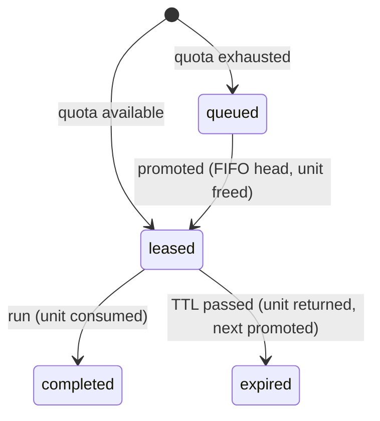

# High-Level Design — Enrichment Lookup Coordinator

Source of truth for requirements: [requirements.md](requirements.md). This document records the design decisions.

## 1. Scope

**Core (must work, must be tested):** request → lease (5 min) → run → expiry/return → FIFO promotion; never exceed quota under ~200 concurrent requests; one active lookup per indicator; idempotent retries.

**Designed for, not built yet:** multiple providers, team-level quota caps, SQS/RabbitMQ job transport, async lookups for playbooks, authentication.

## 2. Architecture

```
Next.js (web) ──HTTP/JSON──▶ Laravel (api) ──▶ PostgreSQL 18
                                  │                ▲
                       worker (queue:work) ────────┤   jobs: database driver now, SQS/RabbitMQ later
                       scheduler (schedule:work) ──┘   lease-expiry sweep every 10 s
```

**All quota correctness lives in the database** (transactions, row locks, constraints), never in process memory.

### API modules (`apps/api/app/Modules`)

| Module | Owns | Public contracts (planned as flows land) |
|---|---|---|
| Shared | Indicator value object + normaliser, `ApiErrorCode`, `Clock`, `TransactionRunner` | — |
| Identity | Team, User, Analyst, `UserRole` | `RequesterDirectory` |
| Providers | Provider, `Verdict`, mock provider | `ThreatIntelProvider`, `ProviderCatalog` |
| Quota | QuotaAllocation | `QuotaLedger` (reserve / release / consume / snapshot) |
| Lookups | LookupRequest, queue, `LookupStatus` | `RequestEnrichment`, `RunLookup`, `ExpireLeases`, `LookupStatusQuery` |

- Layout per module: `Contracts/` (public interfaces, DTOs, enums), `Domain/` (models, repository interfaces), `Application/` (services), `Infrastructure/` (Eloquent repositories, adapters), `Http/`, `<Module>ServiceProvider`.
- Services depend on interfaces (SOLID/DIP); Eloquent lives only in models and `Infrastructure` repositories.
- Cross-module references are **IDs only** (no cross-module Eloquent relations); data crosses through `Contracts` DTOs. DB foreign keys still enforce integrity.
- Dependency rule: `Lookups → {Identity, Providers, Quota}.Contracts → Shared`. Enforced by **Deptrac** (`composer deptrac`, pre-commit and CI).
- Atomicity across modules: the orchestrating service opens one transaction (`TransactionRunner`); other modules' contracts run inside it. Lock order: quota row → lookup rows.
- 12-factor: config via env, logs to stderr, stateless processes (web / worker / scheduler), backing services attached by config, one-off admin processes (migrate, seed).

## 3. Data model

All public IDs are **UUIDv7** (native `uuid`, time-ordered, non-enumerable; DB default `uuidv7()`).
`lookup_queue` keeps a **bigint identity** purely as its FIFO key: a sequence is strictly monotonic across sessions, while UUIDv7 is only monotonic within one connection.

| Table | Purpose | Key constraints |
|---|---|---|
| `teams` | Team membership (one `default` seeded) | `slug` unique |
| `users` | Laravel users; `role` ∈ analyst/playbook/admin, `team_id` | `Analyst` = `User` subclass (single-table inheritance via global scope on `role`) |
| `providers` | Threat-intel providers (one mock seeded) | `slug` unique |
| `quota_allocations` | Units per provider × scope × period. `team_id NULL` = org pool (the only scope enforced now) | `CHECK (reserved + consumed <= quota_limit)`, `UNIQUE NULLS NOT DISTINCT (provider_id, team_id, period_start)` |
| `lookup_requests` | A request and its lease (a lease is a state, not a table) | `UNIQUE (requested_by, idempotency_key)`; partial unique `(provider_id, indicator_type, indicator_value) WHERE status IN ('queued','leased')` |
| `lookup_queue` | FIFO waiting list | `id` identity = arrival order; `lookup_request_id` unique |

`remaining = quota_limit − reserved − consumed`. The daily window is in UTC; a new day means a new allocation row, never a destructive reset.

## 4. Lookup state machine



| Status | Active | Unit | Notes |
|---|---|---|---|
| queued | ✓ | – | has a queue position |
| leased | ✓ | reserved | runnable until `lease_expires_at` |
| completed | – | consumed | `result` is set |
| expired | – | returned | the analyst must request again |

A failed provider call is **not** a state: the request stays `leased` and can be retried within the lease. Transitions are enforced in `LookupStatus::canTransitionTo()` and by guarded SQL (`UPDATE … WHERE status = :expected`; 0 rows affected = rejected).

## 5. Enums, config, shared contracts

- PHP backed enums (source of truth): `LookupStatus`, `IndicatorType` (ip/domain/hash), `Verdict` (malicious/suspicious/harmless/unknown), `UserRole`, `ApiErrorCode`.
- `config/enrichment.php`: `lease_ttl_seconds` (300), `default_daily_quota` (10), `provider` (default slug), `sweep` cadence. Env-driven; exposed to the UI via the API.
- `php artisan contracts:export` generates `apps/web/src/contracts/generated.ts` (const objects + union types + transition map). CI fails on drift. Response DTOs are hand-typed until an OpenAPI spec is warranted.
- Indicators: type auto-detected when omitted (IP via `filter_var`; hash by hex length 32/40/64; otherwise domain regex), then normalised (lowercase, canonical IP).

## 6. Concurrency and flows

- **Request:** lock the quota row (`SELECT … FOR UPDATE`) → if a unit is free, `reserved+1` and insert `leased`; else insert `queued` + a queue row. A unique violation on idempotency or active-indicator returns the existing request (no unit spent). A reused key with a different payload (`request_hash`) → 422.
- **Run:** lock the request; it must be `leased` and unexpired → call the provider → `reserved−1, consumed+1`, `completed`.
- **Expire + promote:** sweep with `FOR UPDATE SKIP LOCKED` (safe with N workers) → `expired`, `reserved−1` → pop the queue head → `reserved+1`, `leased` with a fresh TTL. Expiry is also applied lazily on reads, so correctness does not depend on the worker.
- Lock order is always quota row → request rows, to avoid deadlocks.

## 7. Queues

- **Waiting queue = Postgres table, always.** It must be transactional with quota and answer "position N", which a broker cannot do.
- **Job queue = Laravel Queue.** `database` driver now; SQS (built in) or RabbitMQ (community driver) by config only. Rules: idempotent jobs (at-least-once), ID-only payloads, `after_commit: true`, no correctness depends on the broker, no long delays (SQS caps delays at 15 min).

## 8. Out of scope (documented limitations)

Team-cap enforcement (and per-team FIFO), authentication, outbox/event publishing, audit table, real provider integrations, multi-org.
